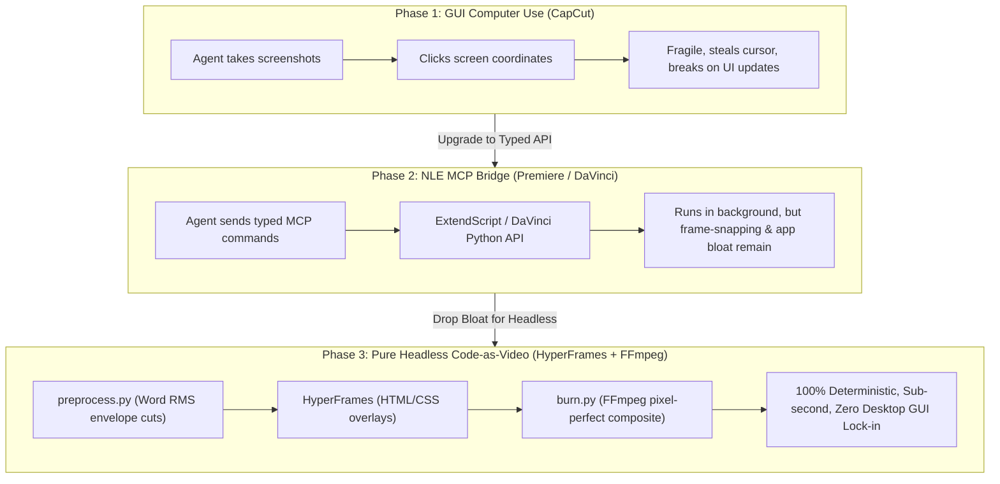

# Jason Cooperson: Claude Video Editor System & Blueprint Analysis

> **Video Reference**: YouTube [`sGt1ACELN4k`](https://www.youtube.com/watch?v=sGt1ACELN4k)  
> **Title**: *I Finally Solved AI Video Editing (Full Guide + FREE Setup)*  
> **Creator**: Jason Cooperson ([AI Leverage Lab](https://www.skool.com/leveragelab/about))  
> **Coupled Web Artifact**: [`claude.ai/artifact/BYH6Mcma5to3kt2KogkEzB`](https://claude.ai/artifact/BYH6Mcma5to3kt2KogkEzB)  
> **Key Production Implementations**: [`lanayepifanova/Claude-Editor`](https://github.com/lanayepifanova/Claude-Editor), [`assafkip/claude-video-editor`](https://github.com/assafkip/claude-video-editor)  
> **Engineering Scope**: 3 Months, 86,000 Lines of Code, 335 Commits, 20+ Skills, 860+ Lines of Production Field Notes  

---

## Executive Summary

In *"I Finally Solved AI Video Editing,"* Jason Cooperson reveals how he automated his entire end-to-end video editing process using **Claude Code**. The entire 21-minute YouTube video was edited autonomously by Claude in Adobe Premiere Pro in 2 hours 42 minutes from a single prompt, multi-take raw footage, and a background music track.

Coupled with the video is his public Claude Artifact ([`BYH6Mcma5to3kt2KogkEzB`](https://claude.ai/artifact/BYH6Mcma5to3kt2KogkEzB)), containing the foundational **System Map & Blueprint Starter Prompt**. Furthermore, open-source production implementations by creators in his ecosystem (notably Lana Epifanova's [`lanayepifanova/Claude-Editor`](https://github.com/lanayepifanova/Claude-Editor)) provide 860+ lines of empirical field notes ([`WORKING-NOTES.md`](file:///Users/georgepaterakis/.gemini/antigravity/brain/52a78260-43b1-4cf1-b797-a0767bbca0c7/scratch/lanaye_working_notes.md)) and refined system rules ([`CLAUDE.md`](file:///Users/georgepaterakis/.gemini/antigravity/brain/52a78260-43b1-4cf1-b797-a0767bbca0c7/scratch/lanaye_claude.md)).

This research report dissects the complete ecosystem:
1. **The Official Blueprint Starter Prompt** from the Claude artifact.
2. **The Architecture of the Local Project Studio** (86,000 lines of code across 20+ skills).
3. **The NLE Decision Matrix**: Why headless background MCP execution beats CapCut screen clicking, and why elite creators eventually drop Premiere in favor of **100% headless scripts + HyperFrames**.
4. **"Presets: The Secret Sauce"**: Overcoming the "AI Slop" taste problem through mathematical design tokens and the compounding `bake_preset` learning loop.
5. **Empirical Post-Production Engineering Rules**: Exact decibel thresholds, hysteresis floors, retake detection algorithms, safe-zone layouts for TikTok UI, audio codec gotchas, and rendering performance traps.
6. **Token Economics & Session Hygiene**: The 73x token multiplier and the "one video per session" mandate.
7. **Actionable Roadmap for AeroEdits**: Direct implementation guidelines for the native Rust/Tauri architecture.

---

## 1. The Official Blueprint Starter Prompt (`BYH6Mcma5to3kt2KogkEzB`)

The companion Claude artifact provides the core prompt and directory blueprint designed to initialize an autonomous video editing agent:

```markdown
# Role & Objective
You are an autonomous Senior Video Editor and Creative Developer AI agent. Your job is to take raw video footage, audio transcripts, and brand preset guidelines, and turn them into a fully polished, publication-ready video edit with zero human babysitting required.

## Core Capabilities & Tools Integration
1. Transcription & Rough Cut: Use WhisperX (or local transcription tools) to analyze word-level timestamps, detect dead air, filler words, and false starts, and execute a precise rough cut.
2. Media Processing: Use FFmpeg to inspect, slice, process, and handle video/audio streams.
3. Motion Graphics & Vibe Matching: Generate UI animations, dynamic captions, and motion elements (utilizing toolkits like HyperFrames/HTML layers) based on established brand or creator style presets.
4. Timeline Control: Interact with the NLE/Editor environment via Model Context Protocol (MCP) or script execution to place cuts, manage tracks, insert B-roll, and adjust audio levels.

## Directory & File Architecture Setup
Initialize the workspace with the following structure:
- /input_footage -> Drop raw clips here.
- /presets        -> Store brand guidelines, color grading LUTs, font styles, and cut-cadence rules.
- /renders        -> Temporary and partial-render files for fast iteration.
- CLAUDE.md       -> System instructions, command logs, and project rules.

## Execution Workflow
When given a raw video asset, execute the following pipeline sequentially:
Step 1: Ingest & Transcribe — Scan raw video, generate word-level timestamps, map out speech rhythm.
Step 2: The Rough Cut — Prune out dead space, silences, and bloopers to lock down primary storytelling spine.
Step 3: Visual Layering & B-Roll — Insert targeted text highlights, zooms, transitions, and graphical context that match the target creator style.
Step 4: Audio Polish & Music — Balance dialogue tracks, layout background tracks, and sync necessary sound effects (SFX).
Step 5: QA & Export — Review timeline logic against preset requirements, render a preview pass, and prepare final export package.
```

---

## 2. System Architecture: The Local Project Folder

Cooperson rejects web-based SaaS video editors in favor of a local file-based architecture where the user owns all code, presets, and media assets.

```
claude-video-editor/
├── CLAUDE.md                   # Global system instructions, rules, and execution constraints
├── AGENTS.md                   # Codex / Cursor multi-agent routing rules
├── presets/                    # THE SECRET SAUCE: Calibrated brand and style recipes
│   ├── branding.json           # Hex colors, font pairings, text tracking, drop shadows
│   ├── animations.json         # GSAP / spring physics curves (pop-in, overshoot, slides)
│   ├── audio_profile.json      # Speech target (-14 LUFS), music bed (-22 dB), ducking curves
│   └── camera_moves.json       # Push-in zooms (1.08x over 0.4s), dynamic framing rules
├── input_footage/              # Raw camera footage, screen captures, audio stems
├── assets/                     # Autonomous web downloads (logos, icons, vector SVGs)
├── renders/                    # Temporary/partial-render proxy drafts for rapid evaluation
└── skills/                     # 20+ modular sub-agent toolsets (intake, rough cut, SFX, grading)
    ├── ingest-transcript/      # WhisperX word-level timestamp generation and pause tagging
    ├── rough-cut/              # Dead-air pruning, filler word stripping, best-take selection
    ├── motion-graphics/        # HyperFrames HTML/CSS/GSAP component generation
    ├── sfx-engine/             # Dynamic transient placement (whooshes, UI clicks, risers)
    ├── color-grade/            # NLE Lumetri / DaVinci node grading presets
    └── qa-linters/             # Pacing and contrast validation gates
```

### The Iron Rule of Local Agents
> *"Always start your Claude Code or Codex session inside the project folder. Attaching it to a random chat won't work because Claude needs to read `CLAUDE.md` and load the 20+ skills dynamically."*

---

## 3. The NLE Evolution: Why Headless Scripts Replace Traditional NLEs

A central chapter of Cooperson’s guide (4:29) analyzes how different editing platforms perform when driven by autonomous coding agents. However, real-world production data from advanced community implementers (Lana Epifanova) reveals a profound structural evolution:



### Why Lana Epifanova Dropped the Premiere Bridge
In [`CLAUDE.md`](file:///Users/georgepaterakis/.gemini/antigravity/brain/52a78260-43b1-4cf1-b797-a0767bbca0c7/scratch/lanaye_claude.md) (line 19):
> *"There is no NLE, on purpose. Premiere Pro and its MCP bridge were removed on 2026-09-21 — she asked for the studio to have no reliance on it. The cut is computed by `edit/preprocess.py`, graphics are rendered by HyperFrames, and `edit/burn.py` composites and encodes the finished video into `output/` with ffmpeg. The whole pipeline is scripts and files; nothing needs an application to be open, and nothing needs a human to touch a timeline."*

Key reasons for abandoning external NLE bridges:
1. **Frame-Snapping Desyncs**: Premiere’s timeline engine forced frame-rate conversions that snapped audio and caption cuts by $\pm 1$ frame, resulting in drift up to 6.7 seconds over a 7-minute cut. Pure FFmpeg cut segments match the overlay down to the single frame (e.g., 1453 frames exactly).
2. **False Alarm Render Verification**: Asking Premiere to export frames for verification frequently exported frames from the wrong sequence or timecode, creating false alarms on work that was already correct.
3. **Application Overhead**: Requiring a multi-gigabyte commercial NLE to be open and licensed on the workstation created unnecessary fragility compared to lightweight Python scripts and FFmpeg.

---

## 4. "Presets: The Secret Sauce" (Overcoming AI Slop)

The video's core conceptual insight (6:36) explains why most AI video tools fail: **LLMs have tools, but zero taste.**

### 1. Tokenizing Taste
Instead of prompting *"add a cool text animation"*, the system extracts and locks down mathematical constants:
- **Kinetic Text**: Font: `Georgia Bold` (Didot's hairlines vanished over video compression), scale overshoot `1.15` peaking at `0.18s`, settling at `1.0` at `0.32s` with `anticipate` easing.
- **Camera Push-In**: 1.08x scale, centered on speaker eyeline, executed across exactly 12 frames (0.4s) using `power2.out`.
- **Music Ducking**: Normal bed at `-20 dBFS`; speech onset drops bed to `-28 dBFS` over 80ms; speech cessation restores bed over 400ms.

### 2. The Compounding "Bake" Loop
When Claude finishes an edit, the creator makes minor adjustments (e.g., shortening a zoom hold or shifting a font color). The creator then issues the compounding command:
> *"Bake what you learned from these manual changes back into the preset."*

Claude updates the JSON/YAML configuration files in `presets/`. Over 5–10 iterations, the system absorbs the creator’s exact subconscious editing style, eliminating future revision rounds.

---

## 5. Empirical Post-Production Engineering Rules

Synthesized from Cooperson’s video and Lana Epifanova’s 860 lines of field notes ([`WORKING-NOTES.md`](file:///Users/georgepaterakis/.gemini/antigravity/brain/52a78260-43b1-4cf1-b797-a0767bbca0c7/scratch/lanaye_working_notes.md)):

### Rule 1: The Exact Silence Removal Recipe
Do not use NLE built-in silence detection (too conservative). Measure the RMS audio envelope and apply this locked recipe:

| Parameter | Calibrated Value | Function |
| :--- | :--- | :--- |
| **Speech Threshold** | **-35 dB RMS** | Above this = speech, keep it. |
| **Hysteresis Floor** | **-37 dB** | Extends keep-region so trailing consonants survive. |
| **Lead-In Padding** | **0.02s** | Tiny breath of air before the first syllable. |
| **Tail Padding** | **0.04s** | Cuts ~2 frames after sound stops (raise to 0.07s if bitten off). |
| **Min Gap to Cut** | **0.05s** | Slices *between words*, not just between sentences. |
| **Min Segment Kept** | **0.08s** | Anything shorter is a bump or mic pop; discard. |
| **Envelope Resolution**| **20ms windows** | 100ms is far too coarse for word-level precision. |

### Rule 2: Quiet Trailing Speech & `restore_speech.py`
When a creator complains that an edit was *"cut too soon"*, do **not** touch the silence recipe. 
- Words dropped at sentence ends (e.g. trailing voice drop to -39 dB) fall below the -35 dB threshold.
- Slicing between words can punch a 0.16s hole in continuous phrases.
- **The Fix**: Run `restore_speech.py` to scan the *removed* regions for runs above -45 dB lasting $\ge 0.06\text{s}$ that are strictly *adjacent* to a cut, extending the neighboring segment over them. Do not extend to isolated blips in the middle of pauses (those are breaths).

### Rule 3: Automated Retake Selection (`retakes.py`)
Standing policy: **The last take is always the keeper.**
- Slices the word timings into lines and compares adjacent sentences within a `--window 6` line span using `difflib.SequenceMatcher`.
- If similarity is $\ge 0.72$, it flags a repeated line or false start.
- Doomed spans are marked in **source time** (not segment indices, because indices shift as earlier cuts are excised).
- Stubs under 0.30s at the boundaries are snapped out to avoid orphan syllable clicks.

### Rule 4: Safe Zones & Orientation-Dependent Layouts

| Parameter | Landscape 16:9 | Vertical 9:16 (TikTok / Reels / Shorts) |
| :--- | :--- | :--- |
| **Caption Position** | Lower Third (`--y 0.82`) | **Upper Quarter (`--y 0.25`)** — Clears TikTok UI |
| **Max Line Length** | ~42 characters | **~24 characters** |
| **B-Roll / Photo Band**| 120 – 845 px (Above caption) | **580 – 1620 px (Below caption, above bottom UI)** |
| **B-Roll Vertical Center**| Centered per beat | **y = 1260 px** (Clears speaker's chin; bottom lands at 1567 px) |
| **Hold Duration** | 1.9 – 4.3 seconds | **1.8 – 3.2 seconds** |

### Rule 5: Visual Treatment of Assets
- **Logos & Line Art**: Knock out backgrounds to pure alpha; they read as ink directly on the footage.
- **Labeled Diagrams & Screenshots**: **Never knock out.** Anti-aliased gray labels become illegible over hair or backgrounds. Keep them on their crisp white/cream card with a border.
- **Zero-Blur Knockout Edges**: Replace soft glowing drop shadows with hard, zero-blur knockout edges.
  - *Performance Benchmarking*: A 4K ProRes 4444 render with large-radius blur glow took **36 minutes and 1.7 GB**. The exact same composition rendered with a zero-blur hard edge took **4 minutes and 513 MB** (9x faster!).

### Rule 6: Burn Verification via Binarized Pixel Deltas
Never verify a composite by asking an NLE to export a frame, and never verify by average frame luma (video noise reads ~1.0 YAVG, masking text presence).
- Binarize the difference between the burn and the uncaptioned master:
  ```bash
  ffmpeg -i burn.mp4 -i master.mp4 -filter_complex "[0:v][1:v]blend=all_mode=difference,lut=y='if(gt(val,60),255,0)'[diff]" ...
  ```
- Count the actual changed ink pixels. The resulting inked frame count tracks the SRT caption cues with 99.8% precision.

---

## 6. Token Economics & Session Hygiene

Lana Epifanova’s production audit revealed that **session token bloat is the single biggest hidden cost in AI video editing**:

| Metric | Long Continuous Session | Fresh Session Bootstrap | Cost Difference |
| :--- | :--- | :--- | :--- |
| **Turns in Session** | 1,285 turns | 1 – 15 turns | — |
| **Cache Reads** | 556,000,000 tokens | ~90,000 tokens | **6,000x bloat** |
| **Tokens per Message Turn**| **435,000 tokens** | **~6,000 tokens** | **73x more expensive** |
| **Image Ingestion Bloat** | 77 images in context | 0 images (verified via text alpha linters) | Eliminates image re-reading |

### The "One Video Per Session" Rule
Because coding agents re-send conversation history on every turn, working on multiple videos in one session causes catastrophic cost bloat. 
- Run a cost-check script (`session-cost.py`). If the token threshold is exceeded, exit immediately and bootstrap a clean session.
- Verify renders via text reports (`check_render.py` reporting alpha bounding boxes) instead of injecting screenshots into agent context.

---

## 7. Actionable Roadmap for AeroEdits

Cooperson’s framework and the Epifanova production lessons provide the exact blueprint for making **AeroEdits** the premier AI-native video editor:

### 1. The Built-in Presets Engine (`presets/`)
Formalize a first-class preset manifest in AeroEdits:
```json
{
  "preset_id": "editorial_fast_pacing",
  "silence_removal": {
    "threshold_rms_db": -35.0,
    "hysteresis_db": -37.0,
    "lead_in_sec": 0.02,
    "tail_sec": 0.04,
    "min_gap_sec": 0.05,
    "min_segment_sec": 0.08
  },
  "retakes": {
    "policy": "last_take_keeper",
    "similarity_threshold": 0.72,
    "window_lines": 6
  },
  "captions": {
    "vertical_y": 0.25,
    "landscape_y": 0.82,
    "font": "Georgia Bold",
    "knockout_edge": "hard_zero_blur"
  },
  "overlays": {
    "vertical_center_y": 1260,
    "safe_band": [580, 1620],
    "hold_duration_range": [1.8, 3.2]
  }
}
```

### 2. Autonomous Asset Retrieval (`asset_fetch`)
Empower AeroEdits' agent to search for and download high-resolution brand assets, logos, and vector art when mentioned in spoken dialogue (as demonstrated in Cooperson's Grokbot demo).

### 3. The `bake_preset` Command
Implement an automated telemetry diff command: when an editor modifies a timeline generated by AeroEdits, clicking **"Bake into Preset"** calculates the mathematical delta and persists it into the active preset schema.

### 4. Native Rust Execution over NLE Bridges
AeroEdits eliminates both the fragility of CapCut GUI clicking and the bloat of Premiere MCP bridges by executing all silence cuts, retake pruning, and HyperFrames compositions natively in its local Rust timeline engine.

### 5. Automated Pre-Render Linters & Text Verification
Integrate `check_render` directly into `graphic_check`: verifying alpha bounds, safe zones, and text contrast headlessly without bloating agent context with dozens of screenshots.
