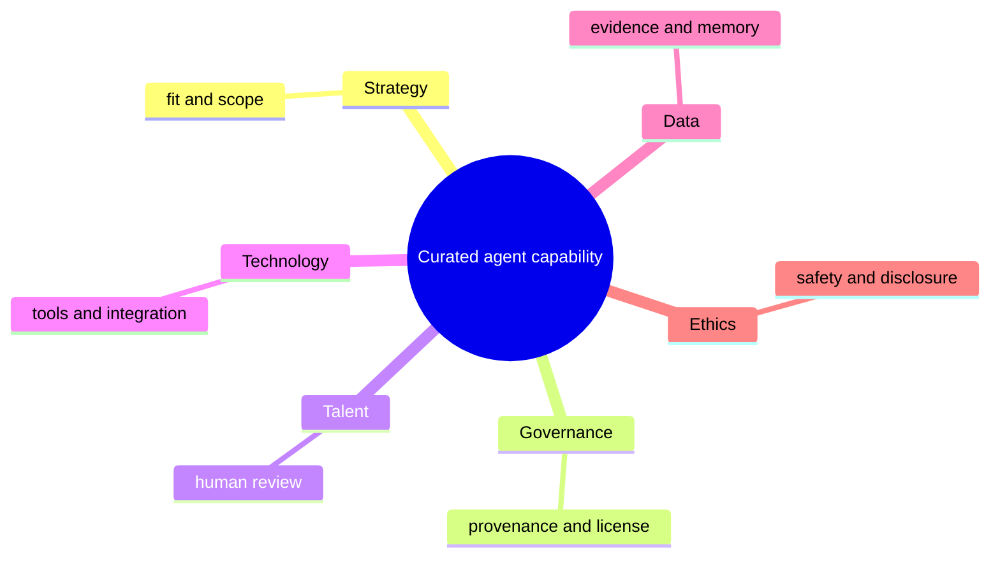

# frankxai/awesome-motion-design-agent-skills

- **Source:** https://github.com/frankxai/awesome-motion-design-agent-skills
- **Kind:** github
- **Captured:** 2026-10-25T15:07:56
- **Evidence grade:** vendor or creator claim. Not tested in this repo. Quotes from a caption are what a creator *said*, not a measurement.

## Repository

- **Repo:** frankxai/awesome-motion-design-agent-skills
- **Description:** Curated motion design agent skills: GSAP, Motion, Remotion, Lottie and Rive for web animation, programmatic video and motion QA. Installable in Claude Code, Codex, Copilot.
- **Homepage:** https://github.com/frankxai/awesome-motion-design-agent-skills
- **Stars:** 80
- **Forks:** 23
- **Open issues:** 8
- **Licence (SPDX):** CC0-1.0
- **Default branch:** main
- **Last push:** 2026-10-24T13:33:09Z
- **Archived:** False
- **Topics:** agent-skills, ai-agents, animation, awesome, awesome-list, claude-code, claude-skills, codex, framer-motion, github-copilot, gsap, lottie, mcp, motion-design, remotion, scroll-animation, video-generation, web-animation

## README

```
# Awesome Motion Design Agent Skills [](https://awesome.re)

<!-- fleet:hero:start -->
<p align="center"></p>
<!-- fleet:hero:end -->

[](https://github.com/frankxai/awesome-motion-design-agent-skills) [](https://github.com/frankxai/awesome-motion-design-agent-skills/commits/main) [](LICENSE)

<!-- fleet:install-badges:start -->
[](#install) [](https://code.claude.com/docs/en/discover-plugins) [](https://github.com/frankxai/awesome-motion-design-agent-skills/releases)
<!-- fleet:install-badges:end -->

> The motion-design stack for AI agents — curated GSAP, Motion, Remotion, Lottie and Rive resources, plus five installable skills that make agents animate with taste.

Every entry links to its primary source and carries a dated pulse. Companion FrankX lists sit at the end, never in front.

**Doctrine:** static hierarchy first. Animate only to clarify state or narrative. Design the reduced-motion path — don't just disable it. Verify on real devices.

<!-- fleet:install:start -->
## Install

Five skills ship in [`skills/`](skills) as open-standard `SKILL.md` folders, so one source feeds every surface.

| Surface                                                                                               | Install                                                                                                                                                                                 |
| ----------------------------------------------------------------------------------------------------- | --------------------------------------------------------------------------------------------------------------------------------------------------------------------------------------- |
| **Any agent** — Claude Code, Codex, Cursor, Copilot, Gemini CLI and 70+ more via `vercel-labs/skills` | `npx skills add frankxai/awesome-motion-design-agent-skills`                                                                                                                            |
| One skill, one agent                                                                                  | `npx skills add frankxai/awesome-motion-design-agent-skills --skill web-motion-auditor -a claude-code` (or `codex`, `cursor`, `github-copilot`, `gemini-cli`; add `-g` for global)      |
| **Claude Code** plugin (all five, auto-updating)                                                      | `/plugin marketplace add frankxai/awesome-motion-design-agent-skills` then `/plugin install motion-design-studio@frankx-motion`                                                         |
| **Claude.ai · Claude Desktop · Cowork**                                                               | Download a skill `.zip` from the [rolling release](https://github.com/frankxai/awesome-motion-design-agent-skills/releases/tag/skills-latest) and upload it in Claude's Skills settings |
| **GitHub Copilot** (cloud agent, CLI, VS Code)                                                        | Copy `skills/<name>/` into your repo's `.github/skills/` — or `npx skills add … -a github-copilot`                                                                                      |
| **Codex**                                                                                             | `npx skills add frankxai/awesome-motion-design-agent-skills -a codex`                                                                                                                   |

Preview with `npx skills add frankxai/awesome-motion-design-agent-skills --list`; verify with `npx skills list`. Scan any third-party pack with `NVIDIA/SkillSpector` before it reaches a live profile.
<!-- fleet:install:end -->

## Choose your workflow

Five first-party skills, one per job. Read the `SKILL.md`, then install only what the work needs.

| Job                                               | Skill                                                                                | Read without installing                                                                                                           | Zip                                                                                                                                     |
| ------------------------------------------------- | ------------------------------------------------------------------------------------ | --------------------------------------------------------------------------------------------------------------------------------- | --------------------------------------------------------------------------------------------------------------------------------------- |
| Product UI motion, stack choice, vector/3D assets | [`motion-director`](skills/motion-director/SKILL.md)                                 | [motion quality rubric](rubrics/motion-quality-rubric.md)                                                                         | [↓](https://github.com/frankxai/awesome-motion-design-agent-skills/releases/download/skills-latest/motion-director.zip)                 |
| Cinematic site choreography                       | [`site-motion-excellence-director`](skills/site-motion-excellence-director/SKILL.md) | [site motion spec](templates/site-motion/SITE_MOTION_SPEC.md) · [excellence gate](rubrics/site-motion-excellence-gate.md)         | [↓](https://github.com/frankxai/awesome-motion-design-agent-skills/releases/download/skills-latest/site-motion-excellence-director.zip) |
| Deterministic video in React                      | [`remotion-video-agent`](skills/remotion-video-agent/SKILL.md)                       | [GIF/video pipeline](playbooks/gif-video-pipeline.md)                                                                             | [↓](https://github.com/frankxai/awesome-motion-design-agent-skills/releases/download/skills-latest/remotion-video-agent.zip)            |
| Generative media routing and finishing            | [`generative-media-director`](skills/generative-media-director/SKILL.md)             | [production workflow](playbooks/image-video-gif-production-workflow.md) · [provider routing](playbooks/video-provider-routing.md) | [↓](https://github.com/frankxai/awesome-motion-design-agent-skills/releases/download/skills-latest/generative-media-director.zip)       |
| Review, capture, motion QA                        | [`web-motion-auditor`](skills/web-motion-auditor/SKILL.md)                           | [site motion rollout](playbooks/site-motion-rollout.md)                                                                           | [↓](https://github.com/frankxai/awesome-motion-design-agent-skills/releases/download/skills-latest/web-motion-auditor.zip)              |

New here? [GETTING_STARTED](GETTING_STARTED.md) walks discovery → read → install → verify.

<details>
<summary>Everything else in the repo</summary>

| Layer     | Files                                                                                                                                                                                                                                                                                   |
| --------- | --------------------------------------------------------------------------------------------------------------------------------------------------------------------------------------------------------------------------------------------------------------------------------------- |
| Templates | [`MOTION.md` brand motion](templates/brand-motion/MOTION.md) · [media brief](templates/creative-briefs/motion-media-brief.md)                                                                                                                                                           |
| Playbooks | [recommended installs](playbooks/recommended-installs.md)                                                                                                                                                                                                                               |
| Contracts | [media job schema](schemas/media-job.schema.json) · [provider routing config](configs/provider-routing.default.json) · [motion pattern registry](patterns/motion-pattern-registry.json)                                                                                                 |
| Maps      | [motion capability matrix](capabilities/motion-capability-matrix.md) · [generative media provider matrix](capabilities/generative-media-provider-matrix-2026-06-22.md) · [Motion Designer MCP spec](mcp/motion-designer-mcp.md) · [stack ranking](rankings/best-motion-design-stack.md) |

</details>

<!-- earned-skill-index:2026-09-28 -->

## Earned third-party skill packs

Operators get leverage from **about 5–7 named workflows**, not bulk dumps. Method: [earned-skills index](https://github.com/frankxai/awesome-hermes-agent-skills/blob/main/docs/EARNED-SKILLS.md) · [safety gate](https://github.com/frankxai/awesome-hermes-agent-skills/blob/main/docs/QUALITY-AND-SAFETY.md).

| Pack                                                                                  | Pulse               | Job                                                          | Install                                          |
| ------------------------------------------------------------------------------------- | ------------------- | ------------------------------------------------------------ | ------------------------------------------------ |
| [greensock/gsap-skills](https://github.com/greensock/gsap-skills)                     | MIT · 15.8k★        | Official GSAP agent skills — timelines, ScrollTrigger, React | `npx skills add greensock/gsap-skills`           |
| [remotion-dev/skills](https://github.com/remotion-dev/skills)                         | 4.8k★               | Official Remotion agent skills                               | `npx skills add remotion-dev/skills`             |
| [LottieFiles/motion-design-skill](https://github.com/LottieFiles/motion-design-skill) | MIT · 1.8k★         | Motion-design principles for Lottie / dotLottie output       | `npx skills add LottieFiles/motion-design-skill` |
| [Orkas-AI/Orkas-VideoStudio](https://github.com/Orkas-AI/Orkas-VideoStudio)           | MIT · 496★          | 14-skill video pack driven by `plan.json`                    | see repo                                         |
| [garrytan/gstack](https://github.com/garrytan/gstack)                                 | MIT · 134k★         | Design / motion QA passes                                    | see repo                                         |
| [nexu-io/open-design](https://github.com/nexu-io/open-design)                         | Apache-2.0 · 98k★   | Design + media workflows, Hermes via ACP                     | see repo                                         |
| [NVIDIA/SkillSpector](https://github.com/NVIDIA/SkillSpector)                         | Apache-2.0 · 18.5k★ | Scan skill packs before install                              | see repo                                         |

Do not install unsigned ZIP/S3 skill blobs or mass-dump skill collections into a live profile.

## Curated catalog

| Project                                                          | Pulse snapshot          | Why it is here                                                           |
| ---------------------------------------------------------------- | ----------------------- | ------------------------------------------------------------------------ |
| [GSAP](https://github.com/greensock/GSAP)                        | Custom license · 28.7k★ | Timeline-grade JavaScript animation; ScrollTrigger for narrative scroll. |
| [Motion](https://github.com/motiondivision/motion)               | MIT · 33.8k★            | React/JavaScript animation with layout and gesture primitives.           |
| [React Three Fiber](https://github.com/pmndrs/react-three-fiber) | MIT · 32.6k★            | Three.js as a React renderer for 3D scenes with fallbacks.               |
| [Remotion](https://github.com/remotion-dev/remotion)             | Custom license · 60.9k★ | Programmatic video rendered from React.                                  |
| [Anime.js](https://github.com/juliangarnier/anime)               | MIT · 73.2k★            | Lightweight timeline animation for DOM, SVG and CSS.                     |
| [Rive WebAssembly](https://github.com/rive-app/rive-wasm)        | MIT · 970★              | State-machine interactive vector animation runtime.                      |
| [dotLottie web](https://github.com/LottieFiles/dotlottie-web)    | MIT · 888★              | Modern Lottie player for web UI motion assets.                           |
| [Phaser](https://github.com/phaserjs/phaser)                     | MIT · 40.4k★            | Real-time web interaction and game-feel patterns.                        |
| [1human reference client](https://github.com/mdagnolops/1human-reels) | MIT client · checked 2026-10-10 | Discover attributed motion references and retrieve recipes with owner-authorized agent access. |
| [Agent Skills](https://github.com/agentskills/agentskills)       | Apache-2.0 · 25.8k★     | The open `SKILL.md` standard these skills follow.                        |
| [skills CLI](https://github.com/vercel-labs/skills)              | MIT · 32.7k★            | Cross-agent installer behind `npx skills add`.                           |
| [product-launch-motion](https://github.com/AbubakrChan/product-launch-motion) | MIT · 253★ | Claude Code skill: website URL to a 60 fps launch video with music, SFX and motion blur. Needs local Playwright and ffmpeg. |

The 1human client serves reference discovery rather than rendering: [public previews](https://reels.1human.tech/) need no account, while recipes, publication and private preferences require owner-approved credentials. The client/examples are MIT; the hosted service, brand and private data are not. Reference licenses remain per creation. Basic participation is free, with a capped beta; this is not a universal importer or evidence of adoption.

<details>
<summary>Editorial curation lens (optional)</summary>



This lens is editorial, not an endorsement or a claim that a project satisfies every pillar.

</details>

<!-- fleet:ecosystem:start -->
## Explore the FrankX Awesome Ecosystem

Companion catalogs. The third-party projects above are this list's primary value.

**Agents & systems** — [agent operating systems](https://github.com/frankxai/awesome-agent-operating-systems) · [hermes agents](https://github.com/frankxai/awesome-hermes-agents) · [hermes agent skills](https://github.com/frankxai/awesome-hermes-agent-skills) · [automation](https://github.com/frankxai/awesome-automation-agent-skills) · [AI CoE](https://github.com/frankxai/awesome-ai-coe)

**Create** — [design](https://github.com/frankxai/awesome-design-agent-skills) · **motion design** · [music](https://github.com/frankxai/awesome-music-agent-skills) · [gamification](https://github.com/frankxai/awesome-gamification-agent-skills)

**Capital** — [agentic income](https://github.com/frankxai/awesome-agentic-income) · [investor](https://github.com/frankxai/awesome-investor-agent-skills) · [wealth](https://github.com/frankxai/awesome-wealth-agent-skills) · [payments](https://github.com/frankxai/awesome-payment-agent-skills)

**Mind & cosmos** — [mind](https://github.com/frankxai/awesome-mind-agent-skills) · [manifestation](https://github.com/frankxai/awesome-manifestation-skills) · [cosmos](https://github.com/frankxai/awesome-cosmos-ai-agents)
<!-- fleet:ecosystem:end -->

## Contribution standard

Open a PR with a primary URL, one-sentence distinct value, current maintenance evidence, license posture, and relevant safety/deployment caveat. New skills must pass `skills-validate` (frontmatter name matches folder, description ≤ 1024 chars, no private paths). No affiliate links, private workflow exports, unverified claims, or product pitches in place of a useful third-party resource.

## Research method

Repository metadata (stars, SPDX license, archived state, last push) was pulled from the GitHub API on **2026-09-28**. "Custom license" means GitHub returned no standard SPDX identifier — read the license before adoption. Counts are dated discovery signals, not rankings. Links are checked on every PR and monthly by [Lychee](.github/workflows/link-checker.yml). Nothing here is financial, legal, medical, or safety advice.
```

## Licence file

```
Creative Commons Legal Code

CC0 1.0 Universal

    CREATIVE COMMONS CORPORATION IS NOT A LAW FIRM AND DOES NOT PROVIDE
    LEGAL SERVICES. DISTRIBUTION OF THIS DOCUMENT DOES NOT CREATE AN
    ATTORNEY-CLIENT RELATIONSHIP. CREATIVE COMMONS PROVIDES THIS
    INFORMATION ON AN "AS-IS" BASIS. CREATIVE COMMONS MAKES NO WARRANTIES
    REGARDING THE USE OF THIS DOCUMENT OR THE INFORMATION OR WORKS
    PROVIDED HEREUNDER, AND DISCLAIMS LIABILITY FOR DAMAGES RESULTING FROM
    THE USE OF THIS DOCUMENT OR THE INFORMATION OR WORKS PROVIDED
    HEREUNDER.

Statement of Purpose

The laws of most jurisdictions throughout the world automatically confer
exclusive Copyright and Related Rights (defined below) upon the creator
and subsequent owner(s) (each and all, an "owner") of an original work of
authorship and/or a database (each, a "Work").

Certain owners wish to permanently relinquish those rights to a Work for
the purpose of contributing to a commons of creative, cultural and
scientific works ("Commons") that the public can reliably and without fear
of later claims of infringement build upon, modify, incorporate in other
works, reuse and redistribute as freely as possible in any form whatsoever
and for any purposes, including without limitation commercial purposes.
These owners may contribute to the Commons to promote the ideal of a free
culture and the further production of creative, cultural and scientific
works, or to gain reputation or greater distribution for their Work in
part through the use and efforts of others.

For these and/or other purposes and motivations, and without any
expectation of additional consideration or compensation, the person
associating CC0 with a Work (the "Affirmer"), to the extent that he or she
is an owner of Copyright and Related Rights in the Work, voluntarily
elects to apply CC0 to the Work and publicly distribute the Work under its
terms, with knowledge of his or her Copyright and Related Rights in the
Work and the meaning and intended legal effect of CC0 on those rights.

1. Copyright and Related Rights. A Work made available under CC0 may be
protected by copyright and related or neighboring rights ("Copyright and
Related Rights"). Copyright and Related Rights include, but are not
limited to, the following:

  i. the right to reproduce, adapt, distribute, perform, display,
     communicate, and translate a Work;
 ii. moral rights retained by the original author(s) and/or performer(s);
iii. publicity and privacy rights pertaining to a person's image or
     likeness depicted in a Work;
 iv. rights protecting against unfair competition in regards to a Work,
     subject to the limitations in paragraph 4(a), below;
  v. rights protecting the extraction, dissemination, use and reuse of data
     in a Work;
 vi. database rights (such as those arising under Directive 96/9/EC of the
     European Parliament and of the Council of 11 March 1996 on the legal
     protection of databases, and under any national implementation
     thereof, including any amended or successor version of such
     directive); and
vii. other similar, equivalent or corresponding rights throughout the
     world based on applicable law or treaty, and any national
     implementations thereof.

2. Waiver. To the greatest extent permitted by, but not in contravention
of, applicable law, Affirmer hereby overtly, fully, permanently,
irrevocably and unconditionally waives, abandons, and surrenders all of
Affirmer's Copyright and Related Rights and associated claims and causes
of action, whether now known or unknown (including existing as well as
future claims and causes of action), in the Work (i) in all territories
worldwide, (ii) for the maximum duration provided by applicable law or
treaty (including future time extensions), (iii) in any current or future
medium and for any number of copies, and (iv) for any purpose whatsoever,
including without limitation commercial, advertising or promotional
purposes (the "Waiver"). Affirmer makes the Waiver for the benefit of each
member of the public at large and to the detriment of Affirmer's heirs and
successors, fully intending that such Waiver shall not be subject to
revocation, rescission, cancellation, termination, or any other legal or
equitable action to disrupt the quiet enjoyment of the Work by the public
as contemplated by Affirmer's express Statement of Purpose.

3. Public License Fallback. Should any part of the Waiver for any reason
be judged legally invalid or ineffective under applicable law, then the
Waiver shall be preserved to the maximum extent permitted taking into
account Affirmer's express Statement of Purpose. In addition, to the
extent the Waiver is so judged Affirmer hereby grants to each affected
person a royalty-free, non transferable, non sublicensable, non exclusive,
irrevocable and unconditional license to exercise Affirmer's Copyright and
Related Rights in the Work (i) in all territories worldwide, (ii) for the
maximum duration provided by applicable law or treaty (including future
time extensions), (iii) in any current or future medium and for any number
of copies, and (iv) for any purpose whatsoever, including without
limitation commercial, advertising or promotional purposes (the
"License"). The License shall be deemed effective as of the date CC0 was
applied by Affirmer to the Work. Should any part of the License for any
reason be judged legally invalid or ineffective under applicable law, such
partial invalidity or ineffectiveness shall not invalidate the remainder
of the License, and in such case Affirmer hereby affirms that he or she
will not (i) exercise any of his or her remaining Copyright and Related
Rights in the Work or (ii) assert any associated claims and causes of
action with respect to the Work, in either case contrary to Affirmer's
express Statement of Purpose.

4. Limitations and Disclaimers.

 a. No trademark or patent rights held by Affirmer are waived, abandoned,
    surrendered, licensed or otherwise affected by this document.
 b. Affirmer offers the Work as-is and makes no representations or
    warranties of any kind concerning the Work, express, implied,
    statutory or otherwise, including without limitation warranties of
    title, merchantability, fitness for a particular purpose, non
    infringement, or the absence of latent or other defects, accuracy, or
    the present or absence of errors, whether or not discoverable, all to
    the greatest extent permissible under applicable law.
 c. Affirmer disclaims responsibility for clearing rights of other persons
    that may apply to the Work or any use thereof, including without
    limitation any person's Copyright and Related Rights in the Work.
    Further, Affirmer disclaims responsibility for obtaining any necessary
    consents, permissions or other rights required for any use of the
    Work.
 d. Affirmer understands and acknowledges that Creative Commons is not a
    party to this document and has no duty or obligation with respect to
    this CC0 or use of the Work.
```

> The repo's licence rule allows MIT, Apache-2.0, GPL-3.0 (as a separate component) and OpenRAIL. Non-commercial, research-only and revenue-capped licences are refused. Read the text, not the SPDX tag alone.

## File tree (49 files, filtered)

- `.github/copilot-instructions.md`
- `AGENTS.md`
- `BUSINESS_CASE.md`
- `CONTRIBUTING.md`
- `GETTING_STARTED.md`
- `LICENSE`
- `README.md`
- `capabilities/generative-media-provider-matrix-2026-06-22.md`
- `capabilities/motion-capability-matrix.md`
- `configs/provider-routing.default.json`
- `estate/current-motion-estate-audit-2026-06-19.md`
- `legal/legal-security-notes.md`
- `mcp/motion-designer-mcp.md`
- `playbooks/gif-video-pipeline.md`
- `playbooks/image-video-gif-production-workflow.md`
- `playbooks/recommended-installs.md`
- `playbooks/site-motion-rollout.md`
- `playbooks/video-provider-routing.md`
- `rankings/best-agent-tools.md`
- `rankings/best-motion-design-stack.md`
- `rubrics/motion-quality-rubric.md`
- `rubrics/site-motion-excellence-gate.md`
- `schemas/media-job.schema.json`
- `skills/generative-media-director/SKILL.md`
- `skills/motion-director/SKILL.md`
- `skills/remotion-video-agent/SKILL.md`
- `skills/site-motion-excellence-director/SKILL.md`
- `skills/web-motion-auditor/SKILL.md`
- `strategy/generative-media-operating-system-2026-06-22.md`
- `strategy/motion-execution-strategy-2026-06-19.md`
- `strategy/site-motion-excellence-system-2026-06-22.md`
- `templates/brand-motion/MOTION.md`
- `templates/creative-briefs/motion-media-brief.md`
- `templates/site-motion/SITE_MOTION_SPEC.md`
