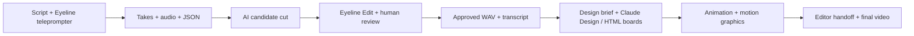

# sirioberati/YouTube-AI-Video-Editing-System

- **Source:** https://github.com/sirioberati/YouTube-AI-Video-Editing-System
- **Kind:** github
- **Captured:** 2026-10-25T16:50:36
- **Evidence grade:** vendor or creator claim. Not tested in this repo. Quotes from a caption are what a creator *said*, not a measurement.

## Repository

- **Repo:** sirioberati/YouTube-AI-Video-Editing-System
- **Description:** Open-source YouTube AI video editing system: Eyeline teleprompter, editing agents, JSON, Claude Design, animation and motion graphics.
- **Stars:** 59
- **Forks:** 18
- **Open issues:** 0
- **Licence (SPDX):** MIT
- **Language:** HTML
- **Default branch:** main
- **Last push:** 2026-10-21T15:05:37Z
- **Archived:** False
- **Topics:** ai-agents, ai-video-editing, animation, claude-design, design, motion-graphics, open-source, teleprompter, video-editing, workflow, youtube

## README

```
<p align="center">
  <a href="https://tein.ai"></a>
</p>

# YouTube AI Video Editing System

> **Style the boards yourself.** The included boards are starter templates, not a finished visual identity. Customize the colors, fonts, shapes, and layouts for your own videos. The animation examples are there to adapt.

**An open-source workflow for recording, AI-assisted editing, design, Claude Design, animation, motion graphics, and the final editor handoff.**

<p align="center"><strong>Want more open-source AI filmmaking workflows?</strong><br>Join the TEIN AI waitlist for updates on new workflows, tools, and releases.<br><a href="https://tein.ai"><strong>Join the TEIN AI waitlist →</strong></a></p>

Eyeline connects the script you read, the takes you record, the source clips you cut, and the visuals you design. The workflow keeps its decisions in readable Markdown and JSON so you can use your own AI agent, change the rules, and keep editing by hand.


[Quick start](#quick-start) · [Workflow](docs/workflow.md) · [Design & motion](docs/design-animation.md) · [JSON formats](docs/formats.md) · [Customize the skills](docs/customization.md) · [Architecture](docs/architecture.md)

## What is included

| Part | What it does |
| --- | --- |
| **Eyeline teleprompter** | Read a script, follow your voice, record microphone audio, mark flubs, track attempts, and optionally sync a display over your local network. |
| **Eyeline Edit** | Review source-linked clips, inspect waveforms and word timings, adjust cut edges, relink camera originals, and export video/audio. |
| **AI editing tools** | Transcribe takes, estimate camera sync and drift, build full-take proxies, propose a candidate cut, and report possible transcription or edge issues. |
| **Agent instructions** | Separate recording, cutting, review, design, animation, and editor handoff responsibilities. Use with a coding agent that can read files and run commands. |
| **Design / Claude Design workflow** | 267 restyled HTML reference boards (246 animated), eight simple static starters, three filled design briefs, and prompts for planning, building, and reviewing boards. Use your design tool of choice, including Claude Design. |
| **Animation / motion graphics** | An animated board library with play/pause/scrubbing, JSON timelines, and a local frame renderer for narration-aligned graphics. |
| **Editor handoff** | A predictable folder tree, approved audio, source mapping, rendered boards, captions, and a finishing checklist for Resolve, Premiere, or another editor. |
| **Placeholder skills** | Fresh, intentionally unconfigured templates you can fine-tune for your own voice, design, pacing, and motion. No private production skills are included. |

This is an early public release, not an unattended one-click editor. Cutting decisions need human review. Speech recognition can turn a mispronounced word into a correctly spelled transcript, and waveform silence is not proof that a word is finished. [Read the limits](docs/cutting.md).

## Quick start

Install **Python 3.10+** and **uv** from their official installers. Chrome or Edge is recommended for browser speech recognition. No API key is required to launch either app.

```bash
git clone https://github.com/sirioberati/YouTube-AI-Video-Editing-System.git
cd YouTube-AI-Video-Editing-System

# Teleprompter — open http://localhost:5317
python3 apps/teleprompter/server.py
```

On Windows, use `py` in place of `python3`. Projects are saved to `~/Eyeline/Projects` by default. Set `EYELINE_DATA` before starting to use another drive. Keep the terminal running.

In a second terminal:

```bash
# Editor — open http://localhost:5320
uv run apps/eyeline-edit/edit_server.py
```

The editor needs an Eyeline project with a cut plan and full-take playback proxies. For a first look without recording anything:

```bash
uv run tools/create_demo.py
uv run apps/eyeline-edit/edit_server.py .local/demo/01-recording
```

The demo creates synthetic camera/audio media locally; it contains no real recordings. See [setup](docs/setup.md) for Windows, external drives, dependencies, and LAN display mode.

## Record → cut → design → animate → finish



### 1. Record with the teleprompter


The recording folder keeps microphone audio, script snapshots, take metadata, captions, and a readable take report together.


### 2. Review the AI-assisted cut


Edit the original source intervals. Keep complete source handles available. A playback proxy covers a whole take; an assembled export never replaces the source clips. The experimental assembler writes `plan.candidate.json`, leaving your active `plan.json` alone.

### 3. Design in Claude Design or your own tool

Work from the **approved final-cut transcript**. The [unbranded design pack](templates/design/README.md) includes:

- **267 restyled HTML reference boards:** 246 animated examples and 21 static/reference layouts, preserving the original motion mechanics. Includes typography, charts, diagrams, reveals, masks, transitions, and motion studies.
- **Eight additional simple static starters:** process, comparison, chart, timeline, layers, code, evidence, and recap.
- **Three filled example briefs:** a review process, a comparison, and a measurement explanation.
- **Three reusable prompts:** transcript to brief, brief to HTML, and board review.
- **A searchable player with Play/Pause, Replay, and scrubbing**, plus [rendering examples](examples/design-starters-timeline.json).


Download or clone the repo, then run `python3 -m http.server 5331 --directory templates/design` from its root and open `http://localhost:5331/` to browse and play the boards. GitHub displays HTML source rather than running it. The library uses a generic editorial theme and system fonts. Its animation timing and effects are preserved, while personal media is replaced with neutral placeholders. **Style the boards yourself before production.** Example copy, quotes, and numbers require verification or replacement. See the [library guide](templates/design/animated/README.md) for dimensions, media/rendering limits, and asset credits.

Start with the [design brief](templates/design-brief.md) and [Claude Design prompt](templates/claude-design-prompt.md), or adapt one of the [filled briefs](templates/design/briefs). The reference HTML is included with personal branding and signature styling removed. Private skills and identifiable source media are not bundled.

### 4. Add animation and motion graphics

Align graphic changes to the approved narration. Each HTML board exposes `window.seek(seconds)` so preview and export use the same deterministic state. Start with [the generic board](templates/board/index.html), customize your visual system, and render from a [timeline JSON](examples/board-timeline.json). See [design and animation](docs/design-animation.md).

### 5. Hand off to your editor

Deliver the approved cut, its WAV and transcript, source-linked plan, design assets, board renders, and timing manifest. The final editor assembles them in Resolve, Premiere, or another NLE. This release provides the files and handoff contract; it does not automate those commercial editors.

## How the system works

The following diagrams show the example workflow behind the project. Their take counts and thresholds are illustrative, not quality guarantees. The public cut generator proposes a candidate for review.


<details>
<summary>See the teleprompter layers, editing layers, and example take-selection breakdown</summary>


Editable source mapping is preserved. Redundant splits between continuous source intervals are not required. QA remains a combination of diagnostics and human listening.


</details>

## Folder structure

```text
apps/                  Teleprompter and Eyeline Edit source
agents/                Generic role instructions and handoffs
skills/                Placeholder SKILL.md files only
config/                Workflow stages and example preferences
schemas/               Core JSON contracts
examples/              Synthetic JSON examples (no production projects)
templates/             Project tree, design pack, briefs, prompts, HTML boards
tools/                 Project scaffolding, demo, render, release checks
docs/                  Setup, architecture, data formats, media and guides
```


The screenshot illustrates a real project's organization. Its project contents and backups are not bundled. Generate your own complete working folder:

```bash
python3 tools/init_project.py "/path/to/My Video"
```

## Bring your own skills

Everything in `skills/` is a **placeholder**, written for this public repository. Fill in your audience, voice, editorial rules, design tokens, animation rules, and examples. Customizing these Markdown files is prompt configuration; it does not train a model. Private channel instructions, voice fingerprints, research libraries, and proprietary skill implementations are excluded.

## Privacy and dependencies

The apps run locally. Browser speech recognition may use your browser vendor's service; QR code and font resources load from public CDNs. Whisper models and Python dependencies download on first use. Sending a transcript to an AI agent or Claude Design follows that tool's data policy. LAN display mode is opt-in and intended only for a trusted private network. See [privacy](docs/privacy.md).

**License:** code and newly authored templates are MIT. TEIN branding is excluded from the MIT grant; its owner retains all rights. Supplied demonstration images and GIFs are documented separately in [media credits](docs/media/README.md). Third-party software and model weights retain their own licenses.

## More open-source workflows from TEIN AI

Get updates on new AI filmmaking workflows, tools, and releases.

**[Join the TEIN AI waitlist →](https://tein.ai)**
```

## Licence file

```
MIT License

Copyright (c) 2026 Sirio Berati

Permission is hereby granted, free of charge, to any person obtaining a copy
of this software and associated documentation files (the "Software"), to deal
in the Software without restriction, including without limitation the rights
to use, copy, modify, merge, publish, distribute, sublicense, and/or sell
copies of the Software, and to permit persons to whom the Software is
furnished to do so, subject to the following conditions:

The above copyright notice and this permission notice shall be included in all
copies or substantial portions of the Software.

THE SOFTWARE IS PROVIDED "AS IS", WITHOUT WARRANTY OF ANY KIND, EXPRESS OR
IMPLIED, INCLUDING BUT NOT LIMITED TO THE WARRANTIES OF MERCHANTABILITY,
FITNESS FOR A PARTICULAR PURPOSE AND NONINFRINGEMENT. IN NO EVENT SHALL THE
AUTHORS OR COPYRIGHT HOLDERS BE LIABLE FOR ANY CLAIM, DAMAGES OR OTHER
LIABILITY, WHETHER IN AN ACTION OF CONTRACT, TORT OR OTHERWISE, ARISING FROM,
OUT OF OR IN CONNECTION WITH THE SOFTWARE OR THE USE OR OTHER DEALINGS IN THE
SOFTWARE.
```

> The repo's licence rule allows MIT, Apache-2.0, GPL-3.0 (as a separate component) and OpenRAIL. Non-commercial, research-only and revenue-capped licences are refused. Read the text, not the SPDX tag alone.

## File tree (397 files, filtered)

- `AGENTS.md`
- `CLAUDE.md`
- `CONTRIBUTING.md`
- `LICENSE`
- `README.md`
- `agents/animation.md`
- `agents/cutting.md`
- `agents/design.md`
- `agents/editor.md`
- `agents/recording.md`
- `agents/review.md`
- `apps/eyeline-edit/app/index.html`
- `apps/eyeline-edit/edit_render.py`
- `apps/eyeline-edit/edit_server.py`
- `apps/eyeline-edit/edit_transcribe.py`
- `apps/eyeline-edit/project.py`
- `apps/eyeline-edit/tools/asr.py`
- `apps/eyeline-edit/tools/assemble_cut.py`
- `apps/eyeline-edit/tools/ingest_proxy.py`
- `apps/eyeline-edit/tools/ingest_sync.py`
- `apps/eyeline-edit/tools/ingest_words.py`
- `apps/eyeline-edit/tools/qa_cut.py`
- `apps/eyeline-edit/tools/qa_edges.py`
- `apps/eyeline-edit/tools/textnorm.py`
- `apps/teleprompter/AGENTS-project.md`
- `apps/teleprompter/index.html`
- `apps/teleprompter/server.py`
- `config/preferences.example.json`
- `config/workflow.json`
- `docs/architecture.md`
- `docs/customization.md`
- `docs/cutting.md`
- `docs/design-animation.md`
- `docs/formats.md`
- `docs/media/README.md`
- `docs/privacy.md`
- `docs/setup.md`
- `docs/validation.md`
- `docs/workflow.md`
- `schemas/board-timeline.schema.json`
- `schemas/cut-plan.schema.json`
- `schemas/edit-plan.schema.json`
- `schemas/take.schema.json`
- `skills/animation/SKILL.md`
- `skills/cutting/SKILL.md`
- `skills/design/SKILL.md`
- `skills/editor/SKILL.md`
- `skills/recording/SKILL.md`
- `skills/review/SKILL.md`
- `skills/writing/SKILL.md`
- `templates/board/index.html`
- `templates/claude-design-prompt.md`
- `templates/design-brief.md`
- `templates/design/README.md`
- `templates/design/animated/README.md`
- `templates/design/animated/boards/A136FileAnatomy.html`
- `templates/design/animated/boards/A137FolderTree.html`
- `templates/design/animated/boards/A138Diff.html`
- `templates/design/animated/boards/A139ErrorFix.html`
- `templates/design/animated/boards/A140Stack.html`
- `templates/design/animated/boards/A141Decision.html`
- `templates/design/animated/boards/AR01Promise.html`
- `templates/design/animated/boards/AR02Thirteen.html`
- `templates/design/animated/boards/AR03Cheaper.html`
- `templates/design/animated/boards/AR04OwnTeam.html`
- `templates/design/animated/boards/AR05HiddenReceipt.html`
- `templates/design/animated/boards/AR06WhoTalking.html`
- `templates/design/animated/boards/AR07ListPrice.html`
- `templates/design/animated/boards/AR08Ladder.html`
- `templates/design/animated/boards/AR09Sellers.html`
- `templates/design/animated/boards/AR10Flow.html`
- `templates/design/animated/boards/AR11Isolate.html`
- `templates/design/animated/boards/AR12LadderTop.html`
- `templates/design/animated/boards/AR13Volume.html`
- `templates/design/animated/boards/AR14PayToGetIn.html`
- `templates/design/animated/boards/AR15MarginOnTop.html`
- `templates/design/animated/boards/AR16Cascade.html`
- `templates/design/animated/boards/AR17CompanyBC.html`
- `templates/design/animated/boards/AR18Commitment.html`
- `templates/design/animated/boards/AR19Arbitrage.html`
- `templates/design/animated/boards/AR20Speed.html`
- `templates/design/animated/boards/AR21LevelDown.html`
- `templates/design/animated/boards/AR22Routing.html`
- `templates/design/animated/boards/AR23LadderUnder.html`
- `templates/design/animated/boards/AR24TwoLines.html`
- `templates/design/animated/boards/AR25Capture.html`
- `templates/design/animated/boards/AR26ReadTerms.html`
- `templates/design/animated/boards/AR27LadderQ.html`
- `templates/design/animated/boards/AR28YearlyPlan.html`
- `templates/design/animated/boards/AR29Shortcut.html`
- `templates/design/animated/boards/AR30Upstream.html`
- `templates/design/animated/boards/AR31EveryRung.html`
- `templates/design/animated/boards/AR32WhereStart.html`
- `templates/design/animated/boards/AR33EveryLine.html`
- `templates/design/animated/boards/AR34CreateWithoutLimits.html`
- `templates/design/animated/boards/B131Calculator.html`
- `templates/design/animated/boards/B132UnitEcon.html`
- `templates/design/animated/boards/B133MarketMap.html`
- `templates/design/animated/boards/B134Request.html`
- `templates/design/animated/boards/B135DocHighlight.html`
- `templates/design/animated/boards/C06Title.html`
- `templates/design/animated/boards/C07Cards.html`
- `templates/design/animated/boards/C08Tile.html`
- `templates/design/animated/boards/C09Stickers.html`
- `templates/design/animated/boards/C108Waterfall.html`
- `templates/design/animated/boards/C109Stacked.html`
- `templates/design/animated/boards/C10NotesArrows.html`
- `templates/design/animated/boards/C110Grouped.html`
- `templates/design/animated/boards/C111Slope.html`
- `templates/design/animated/boards/C112Scatter.html`
- `templates/design/animated/boards/C113KPI.html`
- `templates/design/animated/boards/C114Ranking.html`
- `templates/design/animated/boards/C115Gauge.html`
- `templates/design/animated/boards/C116Heatmap.html`
- `templates/design/animated/boards/C11Data.html`
- `templates/design/animated/boards/C12Verdicts.html`
- `templates/design/animated/boards/C13Limits.html`
- `templates/design/animated/boards/C14Prompt.html`
- `templates/design/animated/boards/C15Social.html`
- `templates/design/animated/boards/C16Illustration.html`
- `templates/design/animated/boards/C238Effects.html`
- `templates/design/animated/boards/C239PriceCard.html`
- `templates/design/animated/boards/C240TableFocus.html`
- `templates/design/animated/boards/C241ChartFocus.html`
- `templates/design/animated/boards/C242AppFocus.html`
- `templates/design/animated/boards/C243CodeFocus.html`
- `templates/design/animated/boards/C244Receipt.html`
- `templates/design/animated/boards/C245NodeGraph.html`
- `templates/design/animated/boards/C246Phone.html`
- `templates/design/animated/boards/C247ChipFilter.html`
- `templates/design/animated/boards/C248KPIFocus.html`
- `templates/design/animated/boards/C249VersusCards.html`
- `templates/design/animated/boards/C250CommentCard.html`
- `templates/design/animated/boards/C251FolderTree.html`
- `templates/design/animated/boards/C252Lens.html`
- `templates/design/animated/boards/C253CardMorph.html`
- `templates/design/animated/boards/C254DealPull.html`
- `templates/design/animated/boards/D42Audit.html`
- `templates/design/animated/boards/D43Bars.html`
- `templates/design/animated/boards/D44Line.html`
- `templates/design/animated/boards/D45Numbers.html`
- `templates/design/animated/boards/D46Pyramid.html`
- `templates/design/animated/boards/D47Cycle.html`
- `templates/design/animated/boards/D48Funnel.html`
- `templates/design/animated/boards/D49Timeline.html`
- `templates/design/animated/boards/D50Venn.html`
- `templates/design/animated/boards/D51Matrix.html`
- `templates/design/animated/boards/D52Tree.html`
- `templates/design/animated/boards/D53Steps.html`
- `templates/design/animated/boards/D54Terminal.html`
- `templates/design/animated/boards/D55Screen.html`
- `templates/design/animated/boards/D56Chapter.html`
- `templates/design/animated/boards/D57Quote.html`
- `templates/design/animated/boards/E117Timeline.html`
- `templates/design/animated/boards/E118TimelineDrag.html`
- `templates/design/animated/boards/E119NodeUI.html`
- `templates/design/animated/boards/E120NodeDrag.html`
- `templates/design/animated/boards/E121Gantt.html`
- `templates/design/animated/boards/E122DragBuild.html`
- `templates/design/animated/boards/E123Workspace.html`
- `templates/design/animated/boards/E17Blur.html`
- `templates/design/animated/boards/E18Swipe.html`
- `templates/design/animated/boards/E19Wipe.html`
- `templates/design/animated/boards/E20ScanPeel.html`
- `templates/design/animated/boards/E21Tokens.html`
- `templates/design/animated/boards/E22Highlight.html`
- `templates/design/animated/boards/E23Veil.html`
- `templates/design/animated/boards/E24Insert.html`
- `templates/design/animated/boards/E25Inserts.html`
- `templates/design/animated/boards/E26Freeze.html`
- `templates/design/animated/boards/E27Closeups.html`
- `templates/design/animated/boards/E28Layers.html`
- `templates/design/animated/boards/E29Hook.html`
- `templates/design/animated/boards/F01Canvas.html`
- `templates/design/animated/boards/F02Colour.html`
- `templates/design/animated/boards/F03Type.html`
- `templates/design/animated/boards/F04Shape.html`
- `templates/design/animated/boards/F05Layouts.html`
- `templates/design/animated/boards/F126ShotBreakdown.html`
- `templates/design/animated/boards/F127Failures.html`
- `templates/design/animated/boards/F128Settings.html`
- `templates/design/animated/boards/F129Iterations.html`
- `templates/design/animated/boards/F130RefStack.html`
- `templates/design/animated/boards/F255LineReveal.html`
- `templates/design/animated/boards/F256Slider.html`
- `templates/design/animated/boards/F257WallHero.html`
- `templates/design/animated/boards/F258PiP.html`
- `templates/design/animated/boards/F259FilmStrip.html`
- `templates/design/animated/boards/F260GlassCaption.html`
- `templates/design/animated/boards/F261Exploded.html`
- `templates/design/animated/boards/F262CinemaOpen.html`
- `templates/design/animated/boards/F263IrisVersions.html`
- `templates/design/animated/boards/F264Laptop.html`
- `templates/design/animated/boards/F265TileAssemble.html`
- `templates/design/animated/boards/F266Knockout.html`
- `templates/design/animated/boards/H142ColdOpen.html`
- `templates/design/animated/boards/H143Agenda.html`
- `templates/design/animated/boards/H144MythFact.html`
- `templates/design/animated/boards/H145Recap.html`
- `templates/design/animated/boards/H146MidRoll.html`
- `templates/design/animated/boards/H147SignOff.html`
- `templates/design/animated/boards/H35Handoff.html`
- `templates/design/animated/boards/K122SamePrompt.html`
- `templates/design/animated/boards/K123Scorecard.html`
- `templates/design/animated/boards/K124BlindTest.html`
- `templates/design/animated/boards/K125SpeedRace.html`
- `templates/design/animated/boards/L106Logos.html`
- `templates/design/animated/boards/L107Session.html`
- `templates/design/animated/boards/M30Motion.html`
- `templates/design/animated/boards/M31Timing.html`
- `templates/design/animated/boards/Main.html`
- `templates/design/animated/boards/P194Easing.html`
- `templates/design/animated/boards/P195Anticipation.html`
- `templates/design/animated/boards/P196Kinetic.html`
- `templates/design/animated/boards/P197MaskReveal.html`
- `templates/design/animated/boards/P198Odometer.html`
- `templates/design/animated/boards/P199Scramble.html`
- `templates/design/animated/boards/P200LineDraw.html`
- `templates/design/animated/boards/P201Parallax.html`
- `templates/design/animated/boards/P202Chrome.html`
- `templates/design/animated/boards/P203Looks.html`
- `templates/design/animated/boards/P204GridWave.html`
- `templates/design/animated/boards/P205Squash.html`
- `templates/design/animated/boards/P206Liquid.html`
- `templates/design/animated/boards/P207SFX.html`
- `templates/design/animated/boards/P208Morph.html`
- `templates/design/animated/boards/P209Flip.html`
- `templates/design/animated/boards/P210Iris.html`
- `templates/design/animated/boards/P211Fan.html`
- `templates/design/animated/boards/P212Snap.html`
- `templates/design/animated/boards/P213Scribble.html`
- `templates/design/animated/boards/P214Marquee.html`
- `templates/design/animated/boards/P215Carousel.html`
- `templates/design/animated/boards/P216Mosaic.html`
- `templates/design/animated/boards/P217Cable.html`
- `templates/design/animated/boards/P218Loader.html`
- `templates/design/animated/boards/P219Chat.html`
- `templates/design/animated/boards/P220LetterWave.html`
- `templates/design/animated/boards/P221Confetti.html`
- `templates/design/animated/boards/P222TapRipple.html`
- `templates/design/animated/boards/P223WaterRipple.html`
- `templates/design/animated/boards/P224FocusRack.html`
- `templates/design/animated/boards/P225Spotlight.html`
- `templates/design/animated/boards/P226LiquidFill.html`
- `templates/design/animated/boards/P227ScribbleFill.html`
- `templates/design/animated/boards/P228CrossOut.html`
- `templates/design/animated/boards/P229Annotate.html`
- `templates/design/animated/boards/P230WordSlot.html`
- `templates/design/animated/boards/P231TypeCollage.html`
- `templates/design/animated/boards/P232TrackingIn.html`
- `templates/design/animated/boards/P233Gooey.html`
- `templates/design/animated/boards/P234Shimmer.html`
- `templates/design/animated/boards/P235Brush.html`
- `templates/design/animated/boards/P236Checklist.html`
- `templates/design/animated/boards/P237Highlighter.html`
- `templates/design/animated/boards/P36Focus.html`
- `templates/design/animated/boards/P37Keyframes.html`
- `templates/design/animated/boards/P38Camera.html`
- `templates/design/animated/boards/P39Stagger.html`
- `templates/design/animated/boards/P62Receipt.html`
- `templates/design/animated/boards/P63Stickers.html`
- `templates/design/animated/boards/P64PriceBars.html`
- `templates/design/animated/boards/P65PriceGrid.html`
- `templates/design/animated/boards/P66Ladder.html`
- `templates/design/animated/boards/P67Metaphors.html`
- `templates/design/animated/boards/P68Characters.html`
- `templates/design/animated/boards/Q34QA.html`
- `templates/design/animated/boards/S148Comment.html`
- `templates/design/animated/boards/S149Post.html`
- `templates/design/animated/boards/S150Showcase.html`
- `templates/design/animated/boards/S151Phone.html`
- `templates/design/animated/boards/S152MindMap.html`
- `templates/design/animated/boards/S32Recipes1.html`
- `templates/design/animated/boards/S33Recipes2.html`
- `templates/design/animated/boards/S58Repo.html`
- `templates/design/animated/boards/S59Readme.html`
- `templates/design/animated/boards/S60ShortPrompt.html`
- `templates/design/animated/boards/S61LongPrompt.html`
- `templates/design/animated/boards/T158ThumbWord.html`
- `templates/design/animated/boards/T159ThumbVS.html`
- `templates/design/animated/boards/T160ThumbLogos.html`
- `templates/design/animated/boards/V153Hook.html`
- `templates/design/animated/boards/V154Chart.html`
- `templates/design/animated/boards/V155Prompt.html`
- `templates/design/animated/boards/V156VS.html`
- `templates/design/animated/boards/V157Rules.html`
- `templates/design/animated/boards/W69Nodes.html`
- `templates/design/animated/boards/W70NodeEdit.html`
- `templates/design/animated/boards/W71Workflows.html`
- `templates/design/animated/boards/X40Ending.html`
- `templates/design/animated/boards/X41EndLayout.html`
- `templates/design/animated/boards/Y163Share.html`
- `templates/design/animated/boards/Y164Versus.html`
- `templates/design/animated/boards/Y165Devices.html`
- `templates/design/animated/boards/Y166Prompter.html`
- `templates/design/animated/boards/Y167Folder.html`
- `templates/design/animated/boards/Y168Retake.html`
- `templates/design/animated/boards/Y169DataVsGuess.html`
- `templates/design/animated/boards/Y170Runbook.html`
- `templates/design/animated/boards/Y171Cleanup.html`
- `templates/design/animated/boards/Y172TextEdit.html`
- `templates/design/animated/boards/Y173Triage.html`
- `templates/design/animated/boards/Y174Sync.html`
- `templates/design/animated/boards/Y175Render.html`
- `templates/design/animated/boards/Y176Math.html`
- `templates/design/animated/boards/Y177Stat.html`
- `templates/design/animated/boards/Y178Shifts.html`
- `templates/design/animated/boards/Y179Hourly.html`
- `templates/design/animated/boards/Y180JobBecame.html`
- `templates/design/animated/boards/Y181Gear.html`
- `templates/design/animated/boards/Y182SystemMap.html`
- `templates/design/animated/boards/Y183Eyeline.html`
- `templates/design/animated/boards/Y184EyelineSetup.html`
- `templates/design/animated/boards/Y185EditWords.html`
- `templates/design/animated/boards/Y186EditTrim.html`
- `templates/design/animated/boards/Y187EyelineEdit.html`
- `templates/design/animated/boards/Y188TakeJson.html`
- `templates/design/animated/boards/Y189Attempts.html`
- `templates/design/animated/boards/Y190EditPlan.html`
- `templates/design/animated/boards/Y191TakeReport.html`
- `templates/design/animated/boards/Y192Delivery.html`
- `templates/design/animated/boards/Y193SystemUI.html`
- `templates/design/animated/catalog.js`
- `templates/design/animated/index.html`
- `templates/design/animated/playback.js`
- `templates/design/boards/01-process.html`
- `templates/design/boards/02-comparison.html`
- `templates/design/boards/03-chart.html`
- `templates/design/boards/04-timeline.html`
- `templates/design/boards/05-layers.html`
- `templates/design/boards/06-code.html`
- `templates/design/boards/07-evidence.html`
- `templates/design/boards/08-recap.html`
- `templates/design/briefs/comparison.md`
- `templates/design/briefs/evidence.md`
- `templates/design/briefs/process.md`
- `templates/design/index.html`
- `templates/design/prompts/brief-to-html.md`
- `templates/design/prompts/review.md`
- `templates/design/prompts/transcript-to-brief.md`
- `templates/design/static.html`
- `templates/editor-handoff.md`
- `templates/project/01-recording/script.md`
- `templates/project/NOTES.md`
- `tests/test_public.py`
- `tools/check_release.py`
- `tools/create_demo.py`
- `tools/init_project.py`
- `tools/render_boards.py`
