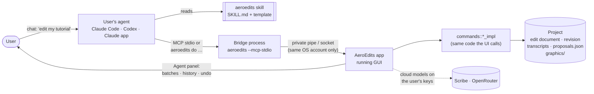
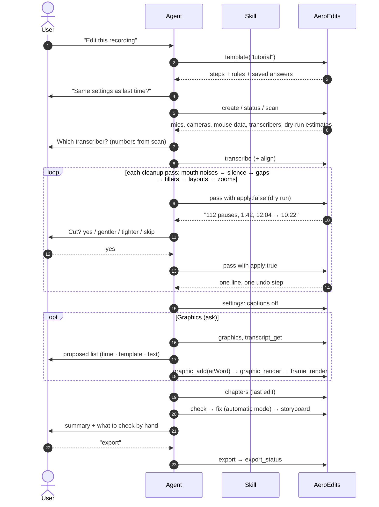

# The AI process today

How a user's agent and AeroEdits work together on a tutorial edit right now. Built from
[`SKILL.md`](../../src-tauri/src/mcp/skill/SKILL.md),
[`templates/tutorial.md`](../../src-tauri/src/mcp/skill/templates/tutorial.md) and
[ai-readiness.md](../plans/ai-readiness.md) phases 1–3.

## 1. Who talks to whom

The same, with the data each part touches:

The agent never edits the project files itself (graphic source is the one exception). It calls
the same `_impl` functions the buttons call, under the same lock and revision checks.

## 2. One tutorial edit, step by step

**Automatic mode** ("auto", "same as last time") skips the questions but still dry-runs every
pass and still stops when a pass would cut more than a quarter of the video, the passes together
more than a third, or the numbers are far from `scan`.

## 3. Where judgement actually sits today

| Step | Who decides | How much model judgement |
|---|---|---|
| Transcribe, align | App (model) | None from the agent |
| Mouth noises, silence, gaps | App (rules) | Agent relays numbers; user picks preset |
| Fillers / retakes | App rules + app's AI review | Agent becomes the reviewer only when no key works (`fillers_review`) |
| Layouts, zooms | App (telemetry rules) | Agent relays numbers |
| Extra cuts (tangents, missed retakes) | **Agent** | `propose_cuts` → user accepts in Agent panel |
| Which shorts | **Agent** (shorts template) or cloud AI | Reads transcript, picks moments, writes titles |
| Which graphics, where, with what text | **Agent** | Picks templates/library items, writes variables; may author HTML |
| Chapters | App (cloud model) | None from the agent |
| Quality review | App (`check`) + agent looks at one `storyboard` | Stills only |

So today the agent is mostly an **operator with good manners**: it sequences deterministic
passes, asks with real numbers and reports in one line. Its creative surface is narrow: extra
cuts, short picks and graphics.

Two honest limits, raised by the [Astra–Premiere review](../astra-premiere-skill-review-2026-10-21.md#good-ideas-worth-adopting):

- **Speed is chosen over coverage.** The filler review reads only windows around flagged words,
  and the skill tells the agent that reading transcripts is expensive. Nothing guarantees that an
  unflagged tangent or abandoned sentence was ever considered.
- **"Checked" means different things.** `check` reads the edit without decoding media, and the
  storyboard is stills. Neither proves a join *sounds* right. The summary at step 8 doesn't say
  which kind of checking each claim rests on.

## 4. What the user sees in the app

- **Agent panel** (dock, tabbed with the Inspector): proposal batches with reasons and per-item
  play buttons; Apply N cuts / Reject / Undo; a History of direct actions with Undo; running
  calls with progress. **Not a chat** — conversation stays in the agent's own app.
- **File > AI agents**: on/off, one-click connect for Claude app and Codex, skill install,
  autopilot switch, activity list.
- Agent cuts also appear striped on transcript words and the timeline.

## 5. The reuse loops that already exist

| Loop | Mechanism |
|---|---|
| Same choices next time | `template_save` answers, "Same as last time?" |
| Graphic you liked → reusable template | `graphic_templatize` → `graphic_check` (gate) → `library_save` with `useWhen` |
| Consistent colours/font/logo | Brand kits, project default + per graphic |
| Saved look | Templates menu: layout, captions, zoom settings, brand |

What's **not** reusable yet: the editing *method* (the user's corrections), style rules beyond
colours, sound choices, and a plan of the edit ([themes.md](themes.md) T1, T2, T10).
