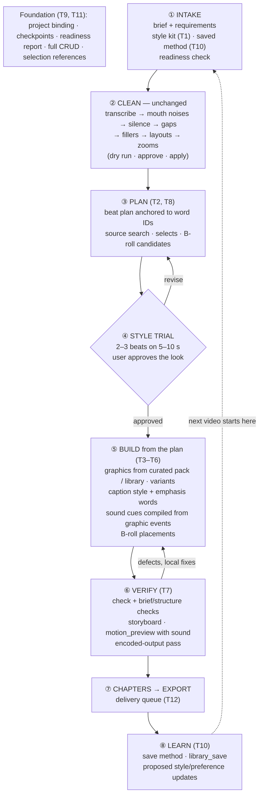
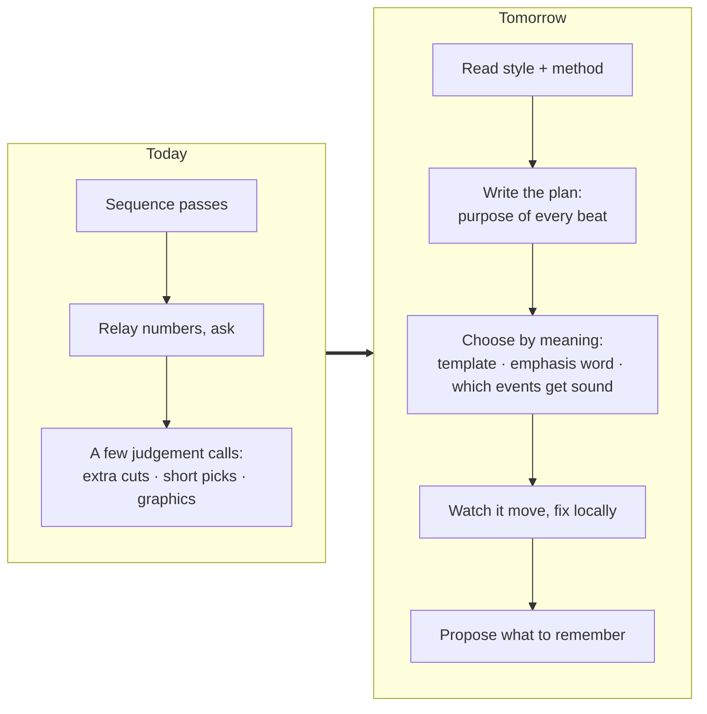

# The AI process tomorrow

How the collaboration in [ai-process-today.md](ai-process-today.md) changes if the proposals in
[themes.md](themes.md) land. This is a synthesis of the research docs, **not a decided design**;
the open choices are in [open-questions.md](open-questions.md).

## The shift in one sentence

Today the agent is an **operator**: it sequences the app's passes and asks good questions.
Tomorrow it is a **director**: it reads a style, writes a plan the user approves, has the app
build that plan deterministically, watches the result move, and writes what it learned back
into reusable artefacts. The app's job grows from "run passes" to "**keep creative decisions
durable**" — style, plan, cues, variants and checkpoints that survive cuts, undo and reopening.

## The loop

The same loop as a flow, with the feedback paths:

Stages ② and ⑦ exist today almost exactly as drawn. ③, ④ and ⑧ are new. ⑤ and ⑥ exist in a
thin form (graphics from 6 templates; stills-only review).

## Stage by stage: today vs tomorrow

| Stage | Today | Tomorrow | New app pieces |
|---|---|---|---|
| ① Intake | `template` + saved answers; "same as last time?" | Also loads one **style profile** and the user's **project rules / saved method**; asks a few questions about style, pace and length before building (Matt Loui's two minutes of answers); checks readiness first; optionally accepts an outside transcript | Style kit, rules store, readiness report, transcript import |
| ② Clean | Passes with dry runs | Same, plus a **fast / thorough** choice: thorough reads every kept transcript page for contextual retakes and reviews residual gaps and joins ([astra P0](../astra-premiere-skill-review-2026-10-21.md#p0-thorough-editorial-workflow-using-existing-tools--small)). Possibly protect spoken "editor notes" and match speech level across takes | Template option only |
| ③ Plan | Agent proposes graphics as a chat list; shorts as a numbered list | A **beat plan** stored in the project: anchor, purpose, treatment, reason, locks; editable in a transcript-row panel; agent can search sources for footage | Beat plan model + panel, `plan_get/set`, `source_search` |
| ④ Trial | — | Build a short sample, user approves the look before it scales | Range-scoped build + preview |
| ⑤ Build | `graphic_add(atWord)` from 6 templates; captions on/off; automatic SFX lane | App **compiles** the approved plan: graphics (curated pack, variants), captions with emphasis, sound cues from event markers, B-roll on a free track. Agent fills variables and makes choices by meaning | Template pack, variants, caption styles, cue compiler, event markers |
| ⑥ Verify | `check` + one `storyboard` + `frame_render` | + brief/structure checks (beat coverage, orphans) + **moving preview with sound** around each beat + final-file pass + a **review record**: per range, whether it was looked at, listened to, or decided by the user, made stale by later edits; a join audition queue | `motion_preview`, render policy, new check rules, review evidence store |
| ⑦ Export | `chapters` then `export` | Same, plus a delivery queue for video + shorts + sidecars | Delivery list |
| ⑧ Learn | `template_save`, `library_save` | "Save this workflow"; corrections proposed as rule updates with examples and a scope (this project / this kind of video / always); the user accepts each. This is the "self-improving skill" every Claude Code creator in the ten-videos set relies on, but gated | Rules/method store **outside** the installed SKILL.md (the installer overwrites it), example store |

## How the agent's role moves

What moves **into the app** (deterministic, cheap, repeatable): timing of cues against visual
peaks, plan anchors through cuts, caption timing, render policy, variant storage, checks.

What moves **to the agent** (judgement, the expensive model's real job): which line needs a
visual, which word to emphasise, which metaphor, which events deserve a sound, whether a
moving preview reads well.

What stays with **the user**: approving the plan, approving the trial, the export go, and
accepting or rejecting what gets remembered.

## What does not change

- No chat panel in the app; conversation stays in the agent's app. The Agent panel grows to
  show plans and trials, not messages.
- Cleanup passes, dry runs, proposals, revision checks, single-step undo.
- HyperFrames-only, app-run renders, no generative video, no second renderer.
- "A pass costs a line of text." New tools must keep responses compact.

## Risks this shift brings

| Risk | Mitigation already proposed |
|---|---|
| More tools → more context cost (53 already) | Merge into existing actions; measure schema cost first ([backlog #16](../future-work.md#16-mcp-discovery-and-connection-diagnostics)) |
| Agent writes to the wrong project as workflows get longer | Project binding before new write tools ([backlog #17](../future-work.md#17-bind-agent-edits-to-the-intended-project)) |
| Style kit becomes an unenforced essay | Make the checkable rules `graphic_check` rules; leave pacing and restraint to judgement (second opinion) |
| Plan drifts from the timeline | Plan stores intent + anchors; app re-resolves; stale beats flagged, never silently moved |
| Cost and time grow unmeasured | Per-stage timing/cost instrumentation; measure cost per *accepted* video, not per run |
| Autonomous fix-and-retry loops waste time or drift | Chase AI explicitly warns against them ([second opinion § B](../second-opinion-video-research-2026-10-21.md#b-what-was-missed)); keep `check` fixes and retries bounded and visible, human at the verify gate |
| Reports overclaim ("reviewed the whole edit" from a contact sheet) | Separate *executed*, *inspected*, *listened*, *approved* in every summary ([astra § 1](../astra-premiere-skill-review-2026-10-21.md#1-separate-execution-verification-and-editorial-approval)) |
| Feedback stays vague ("make it better") | Corrections as timestamps and drawn regions, not adjectives (Tao's Paint sketch) — via selection references (T11) |
