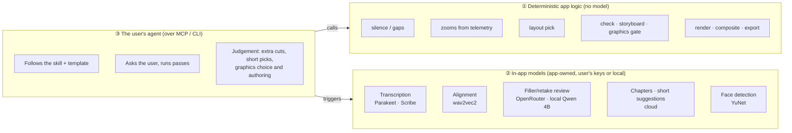

# Current state (21 Oct 2026)

What exists in the code today, as described by the [README](../../README.md),
[ai-readiness.md](../plans/ai-readiness.md) build logs and the source in `src-tauri/src/mcp/`.
Branch `Research-AI-readiness`, last merge `92f80d3`.

## 1. The editor, in one table

| Area | What it does | Driven by |
|---|---|---|
| Timeline | Tracks of clips, non-destructive, undo/redo, clocks map recording time ↔ edited time | [premiere-style-tracks.md](../plans/premiere-style-tracks.md) |
| Transcription | Parakeet (local EN), ElevenLabs Scribe, Scribe via OpenRouter; English + Greek | Models / user's keys |
| Word alignment | wav2vec2 re-times every word to 20 ms, ≤120 ms move | Local model ([word-alignment.md](../plans/word-alignment.md)) |
| Cleanup | Mouth noises, silence (audio), gaps (transcript), fillers + retakes, manual word cuts | Rules + optional AI review |
| Picture | Smart zooms from clicks/typing, layouts (bubble, side by side, camera only, screen only) with timed sections, face centring, window crop, bubble auto-hide | Telemetry, face detection (YuNet) |
| Speed | 0.25×–8× on clips or ranges, pitch kept | Manual / agent on request |
| Captions | Word-highlighted captions, one embedded font | Transcript |
| Audio | Track gain, ducking, denoise, loudness, synthesized click/whoosh lane (off by default) | DSP |
| Graphics | HyperFrames compositions: 6 tutorial templates + blank, brand kits, app-level library with a no-model quality gate, short slots | Pinned runtime, 200 MB download |
| Shorts | Word-range shorts, take shorts (new camera take + footage from the long video), own layouts | Agent or cloud AI picks moments |
| Review | `check` (≈12 defect classes, one-click fixes), `storyboard` (one contact sheet of the edit) | No model |
| Export | H.264/AAC 720p–4K, GPU encoders, shorts at 1080×1920 | FFmpeg / AVFoundation |

## 2. Three kinds of "AI" live in the app

This is the single most useful thing to keep straight. Each research doc tends to blur them.

- **①** is where most of the editing quality comes from. It is cheap and repeatable.
- **②** exists because some things a subscription agent can't do (turn audio into words) or
  shouldn't pay Opus prices for (filler review). Decision 5 keeps these.
- **③** is the orchestrator and, increasingly, the creative director. It never touches files
  directly except graphic source; everything else goes through app actions.

## 3. The agent surface: 53 tools

Registered in [`mcp/skill.rs`](../../src-tauri/src/mcp/skill.rs) (2),
[`mcp/tools.rs`](../../src-tauri/src/mcp/tools.rs) (14) and
[`mcp/actions.rs`](../../src-tauri/src/mcp/actions.rs) (37). Every action is also a CLI
command: `aeroedits do <action> --key value`.

| Group | Tools | Applies how |
|---|---|---|
| Guide | `template`, `template_save` | — |
| Read | `project_info`, `transcript_get`, `timeline_get`, `playhead_get`, `telemetry_get`, `layout_get` | — |
| Look | `frame_render`, `timeline_view`, `storyboard` | — |
| Propose | `propose_cuts`, `propose_edit`, `proposals_list`, `proposal_withdraw`, `undo_batch` | **Waits for the user** in the Agent panel (unless autopilot) |
| Project | `status`, `scan`, `open`, `create`, `undo`, `redo`, `settings`, `media_import` | Directly, one undo step each |
| Speech | `transcribe`, `align`, `mouth_noises`, `silence`, `fillers`, `fillers_review`, `speed` | Directly; `apply: false` = dry run |
| Picture | `layouts`, `zooms`, `faces` | Directly; dry run available |
| Shorts | `shorts`, `short_create`, `short_footage`, `short_from_take` | Directly |
| Graphics | `graphics`, `graphics_install`, `graphic_add`, `graphic_set`, `graphic_write_file`, `graphic_render`, `graphic_check`, `graphic_templatize`, `library_save`, `brand_kits`, `brand_pick` | Directly (source edits have no undo) |
| Finish | `chapters`, `check`, `export`, `export_status` | Directly; export only at the user's go |

The UI has more commands than agents get. For example `transcript_cut_words`,
`transcript_caption_edit` and `transcript_set_word_text` are Tauri commands only; an agent cuts
words through `propose_cuts`. (The [ten-videos review](../ten-ai-editor-videos-2026-10-21.md)
lists these as agent tools; they aren't.)

**Two paths for changes**, decided in phase 2b: built-in passes apply directly (like pressing
the button), while the agent's *own* judgement calls (`propose_*`) wait for approval.

Missing from the surface, noted in research: remove/move a graphic, remove a short, edit or
remove a library item, write a brand kit ([gaps #7](../agent-video-gaps-and-proposals-2026-10-21.md#7-agents-can-create-graphics-but-not-remove-them)).

## 4. The skill that teaches the agent

Shipped inside the app ([`mcp/skill/`](../../src-tauri/src/mcp/skill/)), installed into
Claude Code / Codex skill folders, also served as MCP prompts and server instructions.

| File | Role |
|---|---|
| `SKILL.md` | House rules: start with a template, one pass at a time, ask with numbers, one-line reports, stop on failure, chapters last, graphics rules, storyboard before export |
| `templates/tutorial.md` | 9 steps: project → transcribe → cleanup passes → captions off → graphics (ask) → chapters → check + storyboard → export |
| `templates/shorts.md` | Agent reads transcript, picks 3–5 moments, `short_create`, reviews storyboards |
| `templates/take-shorts.md` | A new take becomes a short; agent picks footage from the long video |
| `export.md` | Export steps |

Saved answers (`template_save`) make the next run one question: "Same as last time?"

## 5. What has and hasn't been verified

From the build logs. Worth knowing before trusting a feature in a real session.

- **Verified on Windows**: bridge + pipe end to end, proposals → accept → undo, actions over CLI,
  graphics install and render in the dev app, check on a real recording, the filler-review eval.
- **Not verified**: macOS for most of the MCP and graphics path; a full real Codex session using
  write tools; the agent's full templatize → check → save loop; brand-kit fonts/logos in a real
  render.

## 6. Known limits that keep coming up

| Limit | Where found |
|---|---|
| Graphics render at **30 fps, 1920 px long side**, even for a 4K/60 export | [short-form part 2](../short-form-reference-review-part-2-2026-10-21.md#a-concrete-motion-quality-gap), herk, AE |
| Graphics are picture-only; no native audio from a graphic | [short-form review](../short-form-reference-review-2026-10-21.md#what-the-current-code-already-provides) |
| `graphic_add(atWord)` resolves the word to a time once; the clip doesn't keep the word | same |
| Captions: one font (Liberation Sans Bold), no emphasis runs or animation presets | short-form, herk |
| Every review tool is a **still** (frame, filmstrip, storyboard); nothing shows motion or plays sound | [gaps #8](../agent-video-gaps-and-proposals-2026-10-21.md#8-there-is-no-motion-review) |
| Undo history is lost on reopen | [future-work #13](../future-work.md#13-project-version-history) |
| Agent proposals check the revision but not *which project* | [future-work #17](../future-work.md#17-bind-agent-edits-to-the-intended-project) |
| Graphic source edits (`graphic_set`, `graphic_write_file`) have no undo | [prompt-to-motion](../prompt-to-motion-workflow-review-2026-10-21.md#current-app-versus-missing-product-flow) |
| No search over source footage, including what was cut | [future-work #14](../future-work.md#14-search-and-summarize-source-footage) |
| No import of an outside transcript (Deepgram, Rev, AssemblyAI JSON) | checked in code 21 Oct; [ten-videos #9](../ten-ai-editor-videos-2026-10-21.md#9-justin-brown--primal-video--davinci-resolve-211-mcp-with-one-big-fix) assumes one exists |
| No folder watch: one project at a time, started by the user or agent | [ten-videos #1](../ten-ai-editor-videos-2026-10-21.md#1-pat-simmons--gpt-6-astra--premiere-pro-text-based-editing-via-computer-use) |
| Music has a sound role (`Role::Background`, "music, game or desktop sound") with ducking, but no music-specific model, library or agent workflow | `sequence/mod.rs`, [ten-videos § capabilities](../ten-ai-editor-videos-2026-10-21.md#capabilities-users-expect-that-we-have-or-lack) |
| No colour grade or LUT as an agent action | ten-videos #4, #6, #8; LUT import is in [backlog ideas](../future-work.md#more-ideas-from-the-competitor-review) |
| The tutorial template reviews fillers in candidate windows by default; a full-transcript read is opt-in, and the skill discourages reading transcripts | [astra-premiere § 2](../astra-premiere-skill-review-2026-10-21.md#2-review-meaning-across-the-full-transcript-when-quality-warrants-it) |
