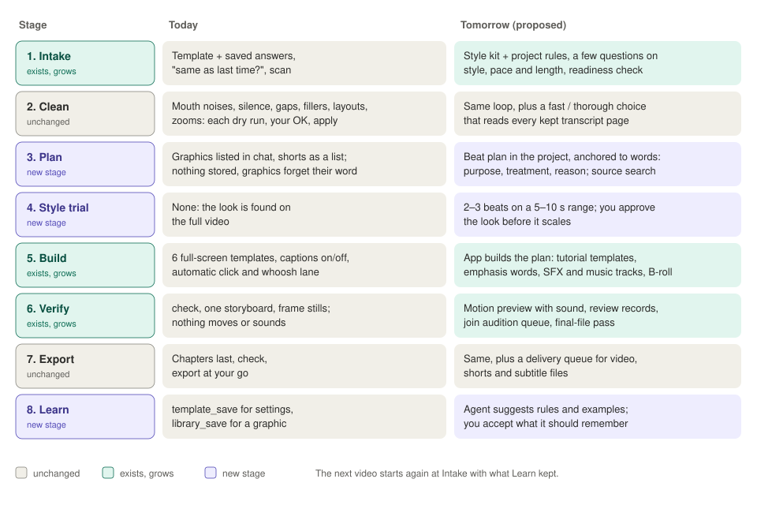

# Vision

Sources: [ai-readiness.md](../plans/ai-readiness.md) (principles, decisions),
[phase-2-handoff.md](../plans/phase-2-handoff.md), [tutorial-motion-workflows.md](../tutorial-motion-workflows.md) (target).

## In one paragraph

AeroEdits is a free, open-source desktop editor for **screen-recorded tutorials** (later:
gaming). It opens `.aero` recordings from AeroShoot — screen, webcam, microphones, system audio
**plus mouse, keyboard and window telemetry** — and turns them into a clean, well-framed video
and shorts. The AI is **the user's own agent** (Claude Code, Codex, the Claude app…) connected
over MCP and paid by the user's own subscription. The app is the tool server; the agent is the
editor; the user approves.

Where the collaboration is heading ([ai-process-tomorrow.md](ai-process-tomorrow.md)):

## Who it is for, right now

George's own channel: AI tutorials (English and Greek), long form and shorts. Gaming is next.
Success means a viewer can follow the action, understand the concept and see the result, with
predictable revisions and reasonable production time. A pretty standalone showreel is not the
target ([tutorial-motion-workflows.md § Target](../tutorial-motion-workflows.md#target)).

## Positioning, sharpened by the 21 Oct research

- **We are the editor.** In the [ten-videos review](../ten-ai-editor-videos-2026-10-21.md#closing-note)
  every creator drives an NLE they already pay for (Premiere, Resolve, Final Cut, CapCut) by
  computer use or a vendor MCP. Resolve 21.1 now ships its own MCP in Studio; that is the
  closest direct threat.
- **Accurate, revisable screen tutorials, not viral-reel ornament.** The
  [second opinion](../second-opinion-video-research-2026-10-21.md#c-where-i-disagree-and-what-would-change-my-mind)
  warns that copying reel aesthetics would pull us away from instructional clarity, and that
  deterministic rendering gives *control*, not proven *visual quality*.
- **The acceptance test is tutorial comprehension and cost per accepted video**: accurate
  cuts, readable UI and captions, preserved cursor targets, measured correction time, and all
  costs (subscriptions, generation, rendering, human review, retries).

## The six principles

From [ai-readiness.md § Principles](../plans/ai-readiness.md#principles):

1. **The app is a tool server, the agent is the editor.** The agent decides; the app does
   everything deterministic (cuts, rendering, alpha, compositing, mapping time through edits).
2. **The agent proposes, the app checks, the user accepts.** Proposals are batches, one undo
   step each. Autopilot can accept automatically.
3. **Text first, pixels when needed.** Transcript and telemetry (~10–20 KB) are the working
   surface; frames only at decision points.
4. **Check the output, not the plan.** Graphics are checked over real footage; cuts against the transcript.
5. **Pin to meaning, not to time.** Graphics and B-roll hang off words or click events.
6. **One source for the look.** A brand kit feeds every graphic and caption.

## Where AeroEdits wins (and must keep winning)

Repeated across nearly every research doc:

- **Tutorial-specific signals no transcript-only editor has**: clicks, typing, shortcuts,
  windows, resting pointer, face position. They drive zooms, layouts, window crop, bubble hide.
- **Cut accuracy**: word alignment with guardrails, word-edge refinement, per-source vetoes.
- **Approve-before-apply** with revision checks and single-step undo.
- **No-model verification**: `check` before export, the graphics gate, `storyboard`.
- **Deterministic rendering** of editable HyperFrames source — so a better composing model
  shows up as a better edit ([agent-video-gaps § the one finding](../agent-video-gaps-and-proposals-2026-10-21.md#the-one-finding-that-matters-most)).
- **Low running cost**: one line of text per pass, local transcription, local fallback review.

Caveat from the second opinion: these are capabilities we *have*; that a competitor's video
doesn't show an equivalent is not proof they lack one. Claim "we have", not "only we have".

## Decisions that are settled

From [ai-readiness § Decisions](../plans/ai-readiness.md#decisions-2026-10-13), the handoff and later plans.

| Decision | Date |
|---|---|
| AI only via the user's agent over MCP; no chat panel or model calls on that path | 13 Oct |
| Transport: `aeroedits --mcp-stdio` bridge → private named pipe / 0700 socket. No port, no token, no script tool | 13 Oct |
| HyperFrames is the only graphics engine; the app runs renders; WebM VP9 alpha cache | 13 Oct |
| Existing in-app AI passes stay (transcription, fillers/retakes, chapters, shorts); the agent is a second source of the same suggestions | 13 Oct |
| No one-call cleanup: each pass is dry-run, approved, then run | 15 Oct |
| Chapters last, right before export | 15 Oct |
| Graphics come after cuts, are never chopped, play full screen over everything (or in a short's slot) | 15 Oct |
| OpenRouter/OpenAI is the default filler review; local Qwen only without a key | 21 Oct |
| Sound effects off by default | 20 Oct |
| Layouts: one shared style per timeline, sections anchored in recording time | 21 Oct |
| **Not doing**: Remotion as a second renderer, chasing After Effects, generative video, a public skill marketplace | 21 Oct ([gaps § what we should not do](../agent-video-gaps-and-proposals-2026-10-21.md#what-we-should-not-do)) — proposed by research, not yet confirmed by George; the second opinion softens the reasons (see [themes § parked](themes.md#parked-or-rejected)) |

## The test every new feature should pass

From [agent-video-gaps § the test](../agent-video-gaps-and-proposals-2026-10-21.md#the-test-to-apply-to-each):

> Does this make the agent's output more checkable without the user watching every frame?
