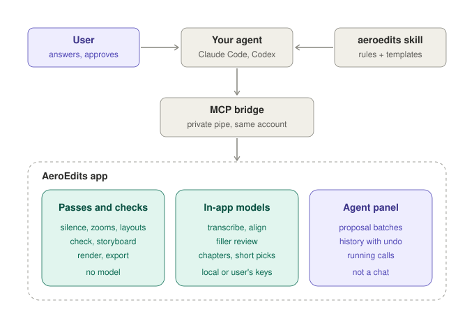
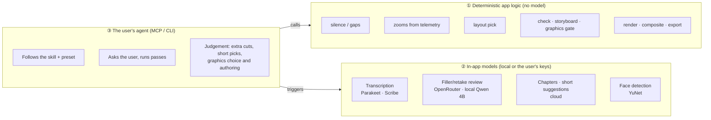
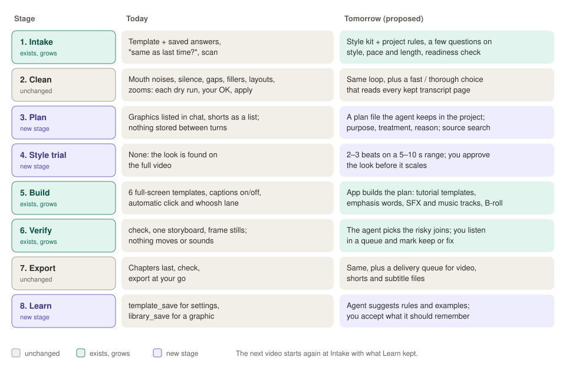

# AeroEdits: what it is and what it does today

Status as of 24 Oct 2026 (branch `improvements`). This is the
one description of the product. How it is built is in [architecture.md](architecture.md); what
is missing is in [gaps.md](gaps.md); what we do next is in [roadmap.md](roadmap.md).

## In one paragraph

AeroEdits is a free, open-source desktop editor (Windows first, macOS second) for
**screen-recorded tutorials**. It opens `.aero` recordings made by AeroShoot: screen, webcam,
microphones and system audio, **plus mouse, keyboard and window telemetry**. It turns them into
a clean, well-framed long video and vertical shorts. The AI is **the user's own agent** (Claude
Code, Codex, the Claude app…) connected over MCP or the `aeroedits do` command line and paid by
the user's own subscription. The app is the tool server, the agent is the editor, the user
approves.

## Who it is for

George's own channel first: AI tutorials in English and Greek, long form and shorts. Gaming is
next. Success means a viewer can follow the action, understand the concept and see the result,
with predictable revisions and reasonable production time. A pretty showreel is not the target.

**The acceptance test for any feature:** does it make tutorials more accurate, readable and
revisable, at a lower **cost per accepted video** (subscriptions, generation, rendering, human
review and retries, divided by videos actually published)? And for agent features: *does it make
the agent's output more checkable without the user watching every frame?*

## Principles

1. **The app is a tool server, the agent is the editor.** The agent decides; the app does
   everything deterministic (cuts, rendering, alpha, compositing, mapping time through edits).
2. **The agent proposes, the app checks, the user accepts.** Agent judgement calls arrive as
   batches, one undo step each. Built-in passes apply directly, like pressing the button.
3. **Text first, pixels when needed.** Transcript and telemetry (~10–20 KB) are the working
   surface; frames only at decision points.
4. **Check the output, not the plan.** Graphics are checked over real footage, cuts against the
   transcript.
5. **Pin to meaning, not to time.** Things hang off words, clicks and recording time, so cuts
   don't knock them out of place.
6. **One source for the look.** The project's style (brand colours, fonts and logo, the
   graphics look, the caption look and the frame) dresses every graphic, caption and frame.

## Where AeroEdits wins, and must keep winning

These are capabilities we *have*. That a competitor's video doesn't show one is not proof they
lack it, so we say "we have", not "only we have".

- **Tutorial signals no transcript-only editor has:** clicks, typing, shortcuts, the front
  window, a resting pointer, the face position. They drive zooms, layouts, window crop and the
  bubble hiding.
- **Cut accuracy:** word-edge refinement, per-source
  vetoes in two-source mode, tagged sounds.
- **Approve-before-apply:** revision-checked proposals, one undo step per batch.
- **Verification without a model:** `check` before export, the graphics gate, `storyboard`.
- **Editable, deterministic graphics:** HyperFrames source the agent can rewrite and the app
  re-renders, so a better composing model shows up as a better edit.
- **Low running cost:** one line of text per pass; the rules come once, from `preset`. A whole
  tutorial edit with graphics cost $0.27 of agent time in EVAL-1 run 4 (24 Oct).
- **A typed API instead of computer use:** no OS accessibility permissions, no screen scraping.

## Features today

| Area | What it does | Driven by |
|---|---|---|
| Timeline | Tracks of clips (V1…, A1…), linked picture and sound, magnetic ripple, non-destructive | Clocks map recording time ↔ edited time |
| History | Undo and redo that survive closing the app (up to 2 GB a project, no step limit), an agent's whole run undone as one step, named checkpoints (one saved before every agent run) | `history/` in the project |
| Presets and styles | A **Preset** per kind of video (Tutorial, Shorts, Clips or your own: cleanup levels, captions, zooms, layouts, export settings, the agent's method, your rules); a **Style** for the look (colours, fonts, logo, graphics look, caption look, frame; Light, Dark or your own). A project stores only what it changed, shown as "changed here" chips | Preset menu, Inspector's Style page |
| Import | `.aero` recordings, video, audio, images, folders; any recording or import is just an asset | — |
| Transcription | Online by default: Scribe detects the language (ElevenLabs, then OpenRouter); Parakeet Unified EN or Verbatim (TDT v3) locally for English | The user's key, or the local model |
| Cleanup | Mouth noises (mute), mouth-click repair (`adeclick`), silence (audio), gaps without words (transcript), fillers and retakes (rules + AI review), manual word cuts | Rules; AI review by OpenRouter/OpenAI, local Qwen 4B without a key |
| Speed | 0.25×–8× on clips or ranges, pitch kept | Manual, or the agent on request |
| Zooms | Suggested from clicks, dwell, click clusters and typing (caret follow) | Telemetry |
| Layouts | Bubble (3×3 grid, S/M/L, shapes), side by side (fit/fill, any share), camera only (punch-in), screen only; a base layout plus sections anchored in recording time; favourites; **Pick from the recording** (rest, busy, hook rules) | Telemetry, face tracks |
| Camera | Face centring on every camera slot (YuNet, found once per recording), hand framing per clip | Local model |
| Telemetry polish | Window crop to the front window, bubble hides under activity, shortcut badges, click/whoosh lane (off by default) | `windows.jsonl`, `keys.jsonl`, `events.jsonl` |
| Captions | The style's title font (a .ttf, .otf, .woff or .woff2 file, or an installed family; else Inter Display, bundled) at its caption weight; one emphasis word per caption in the accent, picked by the agent; pop-in, karaoke or static; give way to full-frame graphics; English and Greek, 16:9 and 9:16 | Transcript |
| Audio | Track gain, denoise, speech ducking, loudness normalisation to -14 LUFS by default with a peak leveller, crossfades at cuts | DSP |
| Graphics | HyperFrames compositions (GSAP allowed): tutorial templates + blank in a light app style, one look per video from its style, an app-level library behind a no-model quality gate, short modes (full, split beside the face, over the face); rendered at the export's frame rate in the background, so an export of unchanged graphics starts at once | Pinned runtime (200 MB download on first use) |
| Shorts | Two tabs. **Shorts** start from a take (a new camera take, cleaned like any recording, with footage and graphics from the video or the library under it, each piece at its own speed). **Clips** cut word ranges from the video that follow its edits or get their own timeline | The agent, or the app's cloud AI for clips |
| Chapters | YouTube chapters from the transcript, checked before export | The agent when connected, else the app's cloud AI |
| Review | `check` (≈12 defect classes, one-click fixes each its own undo step, **Remove all blips**) and `storyboard` (one contact sheet of the edit) | No model |
| Export | H.264/AAC, 720p–4K, Medium / High / Ultra, GPU encoders (NVENC, AMF, QSV, else x264), a streamed log; shorts at 1080×1920; subtitles (SRT, VTT), the transcript (text, Markdown) and the sound (WAV) as files | FFmpeg (Windows/Linux), AVFoundation (macOS) |

## Three kinds of "AI" in the app

Most research docs blurred these. Keep them apart.

- **①** is where most of the editing quality comes from: cheap and repeatable.
- **②** exists because a subscription agent can't turn audio into words, and shouldn't pay
  Opus prices for filler review.
- **③** orchestrates and makes the judgement calls. It never touches project files directly,
  except graphic source.

## How an agent edits a tutorial today

The agent reads the shipped skill (`src-tauri/src/mcp/skill/`), then follows the Tutorial
preset's method:

1. `preset` (`name: tutorial`) → steps, rules, the user's own rules and the preset's choices,
   which run as set without asking.
2. `create` / `status` / `scan` → mics, cameras, mouse data, transcribers, estimates.
3. `transcribe` (online, the language detected).
4. For each pass (mouth noises → silence → gaps → fillers → zooms; layouts only if the user
   raises them): dry run (`apply: false`), ask the user with real numbers, then run. One line
   back, one undo step.
5. Captions off (unless a short). Graphics only if the user wants them: proposed as a table,
   then one `graphic_add` with every item → `graphic_render` → `frame_render`.
6. `chapters` last, then `check` (+ fixes) and `storyboard`.
7. Export only on the user's go.

**Automatic mode** ("auto", "same as last time") skips the questions and the dry runs: each
pass runs with `guard: true`, and the app holds it (and says why) when it would cut more than
a quarter of the video, or the cleanup more than a third of what was recorded. A short from a
take follows the **Shorts** preset the same way (`preset` `name: shorts`).

**Fast or thorough review** is asked once per video (and saved). Fast looks only where the
rules flagged something; thorough also reads every kept word for abandoned sentences,
restarts and tangents, proposes those cuts, and checks the joins. Either way the closing
summary keeps what was done, looked at, heard and approved apart.

Where judgement sits:

| Step | Who decides |
|---|---|
| Transcribe, mouth noises, silence, gaps, layouts, zooms | The app (models and rules); the agent relays numbers |
| Fillers and retakes | App rules + the app's AI review; the agent reviews only without a key (`fillers_review`) |
| Extra cuts (tangents, missed retakes) | **The agent** → `propose_cuts` → the user accepts |
| Which clips, and what goes under a take short | **The agent**, or the app's cloud AI for clips |
| Which graphics, where, with what text | **The agent** |
| Chapters | **The agent** when connected, else the app's cloud AI |
| Quality review | `check` + one `storyboard` (stills only) |

So today the agent is an **operator with good manners**: it sequences passes, asks with numbers
and reports in one line. Its creative surface is narrow: extra cuts, short picks and graphics.

**What the user sees:** an **Agent panel** (docked, tabbed with the Inspector; deliberately not a
chat) with proposal batches, reasons, per-item play buttons, Apply / Reject / Undo, a history
of direct actions and running calls (each with a Stop); **File > AI agents** for on/off,
one-click connect for the Claude app and Codex, skill install and the autopilot switch.

**Reuse loops that exist:** presets (the method, the user's rules and the saved choices) and
styles of the user's own; `graphic_templatize` → `graphic_check` → `library_save`. Not reusable
yet: sound choices, a plan of the edit.

## The agent surface: 55 tools

30 are in the list every agent is sent; 25 that an edit rarely needs are behind `more`, which
gives one's arguments or runs it (COST-2, so the list stays about 15k tokens). Every tool is
also a CLI command, `aeroedits do <tool> --key value`. Tools return **text and PNG only**.

| Group | In the list | Behind `more` | Applies how |
|---|---|---|---|
| Guide | `preset`, `library` (styles, presets, layouts), `more` | — | Choosing a style or preset is one undo step |
| Read | `project_info`, `transcript_get` | `timeline_get`, `playhead`, `source_search`, `telemetry_get`, `layout_get`, `captions` | — |
| Look | `frame_render`, `timeline_view`, `storyboard` | — | — |
| Propose | `propose_cuts`, `proposals_list` | `propose_edit`, `proposal_withdraw`, `undo_batch` | Waits for the user in the Agent panel (unless autopilot) |
| Project | `status`, `scan`, `open`, `create`, `undo` (`run: true`: the agent's whole run), `settings` | `redo`, `checkpoint`, `media_import` | Directly, one undo step each; the app saves a checkpoint before each agent run |
| Speech | `transcribe`, `mouth_noises`, `silence`, `fillers`, `fillers_review` | `speed`, `transcript_fix` | Directly; `apply: false` is a dry run, `guard: true` the automatic check; word fixes are not undo steps |
| Picture | `zooms` (automatic and single zooms) | `layouts`, `faces` | Directly; dry run available |
| Shorts (from a take) | — | `short_from_take`, `short_footage`, `shorts` (list, rename, remove) | Directly; footage and graphics under a take as a batch |
| Clips (cut from the video) | — | `clips` (list, create, find, range, rename, remove) | Directly; `find` only adds clips |
| Graphics | `graphics`, `graphic_add`, `graphic_set` (incl. move, remove, style), `graphic_render` | `graphics_install`, `graphic_write_file`, `graphic_check`, `graphic_templatize`, `library_save`, `library_remove` | Directly (source edits and the library have no undo; checkpoints keep the files) |
| Finish | `chapters`, `check`, `export`, `export_status` | — | Directly; export only on the user's go |

The agent can do nearly everything the UI does; what stays UI-only is mostly playback, preview
hit-testing and API keys. Every writing tool takes the project's `project` id. Details in
[gaps.md](gaps.md#3-agent-surface).

## Platforms

| | Windows | macOS |
|---|---|---|
| Edit, zooms, cleanup | Yes | Yes |
| Preview and playback | wgpu preview drawn under a transparent webview, WASAPI audio | Swift/AVFoundation bridge |
| Export | FFmpeg (bundled) | Swift/AVFoundation bridge (`AEROEDITS_MEDIA_BACKEND=ffmpeg` to try the shared one) |
| Local transcription | CUDA (with the GPU pack), DirectML or CPU | Not in the macOS build yet |

## What is verified and what is not

From the build logs. Know this before trusting a feature in a real session.

- **Verified on Windows:** the MCP bridge and pipe end to end; proposals → accept → undo; actions
  over the CLI; graphics install and render in the dev app; `check` on a real recording; layouts
  in the dev app; the filler-review evaluation; history across restarts and undoing an agent's
  run; whole agent edits of a real tutorial and a take short ([EVAL-1](plans/evaluation.md), four
  runs); a style's font file in captions and graphics; stopping a long call. On 25 Oct, three
  real Codex sessions (`codex exec`, CLI 0.163) against the dev app: write tools (silence,
  check, a library sound, undo); the whole templatize → check → save → remove loop over MCP; a
  style with a logo used by a graphic, rendered and exported (logo seen in the MP4's frame).
- **Codex needs per-tool approval for write tools:** `codex exec` refuses every tool not marked
  read-only ("requires approval, but approval policy is never") until the user adds
  `[mcp_servers.aeroedits.tools.<name>] approval_mode = "approve"` (the Codex app asks
  instead). Read-only tools, images included, work without it.
- **Not verified:** macOS for most of the MCP and graphics path.

## The AI loop we are heading to

Today the agent is an operator; the proposals in [roadmap.md](roadmap.md) make it a director:
it reads the user's rules, writes a plan the user approves, has the app build that plan
deterministically, watches the result move, and proposes what to remember. The app's job grows
from "run passes" to "keep creative decisions durable": notes, plans, cues, variants and
checkpoints that survive cuts, undo and reopening. This is a direction, not a decided design.

What does **not** change: no chat panel in the app; cleanup passes the user can check first,
proposals, revision checks and single-step undo; HyperFrames as the only renderer; "a pass costs a line
of text".
