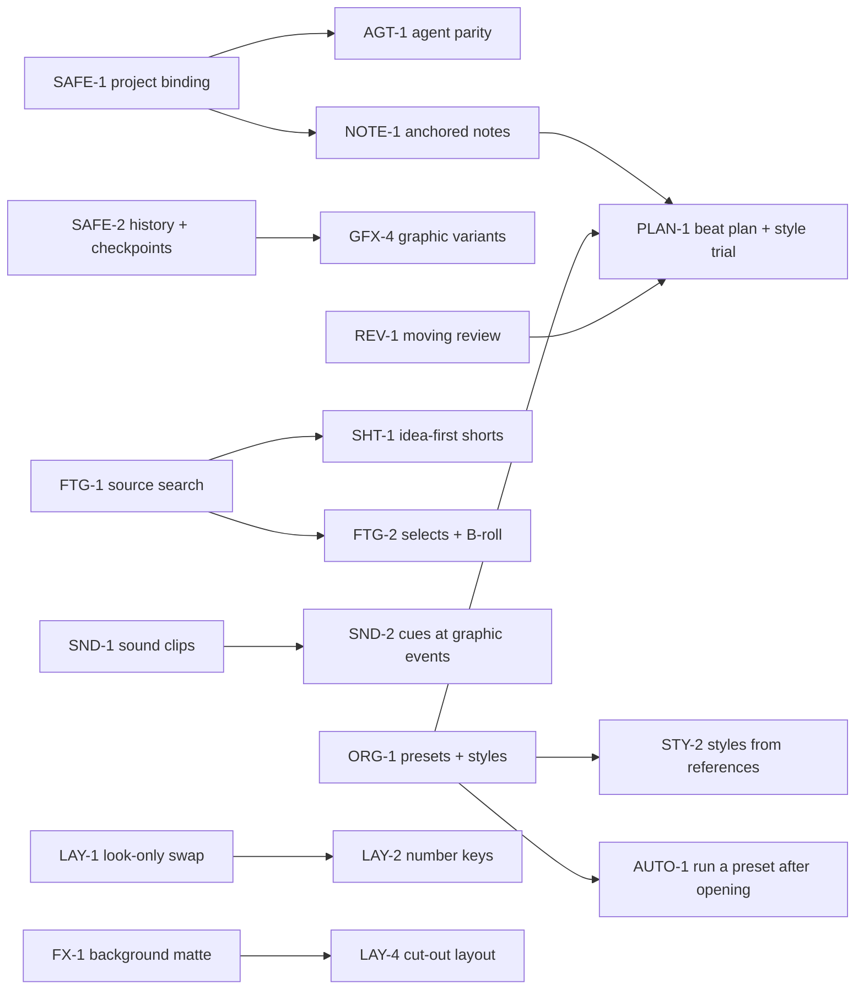

# Roadmap

The one ordered plan. It replaces the old backlog (`future-work.md`), the reconciled roadmap and
the six competing "recommended orders" in the research docs. Each item names its gap in
[gaps.md](gaps.md); decisions that block an item are in [decisions.md](decisions.md).

**Sizes:** S ≈ up to two days, M ≈ up to a week, L = more than a week.
**Rules for this file:** pick items top-down within a tier unless George says otherwise. When an
item starts, link its plan (in `plans/`); when it ships, move it to [Done](#done) with the date
and delete its details here. Keep IDs stable; never renumber.

## The logic of the order

**Milestones (decided 21 Oct):** (1) a great long-form tutorial, (2) tutorial shorts, (3) gaming
shorts and gaming videos. Everything in Now and Next serves milestone 1; shorts work (SHT-*)
follows; gaming work is not scheduled yet.

1. **Done by 24 Oct: what exists is safe, complete and measured, and settings have one home.**
   Project binding, agent parity, history and checkpoints, the EVAL-1 baseline, presets and
   styles, one look for all graphics, caption type, graphics ready before export.
2. **Next: a place for intent, and sight.** Notes anchored to the edit, a moving preview, rules
   the agent proposes, and the basic craft surfaces still missing (sound clips, source search).
3. **Later: build the director loop on those foundations.** Beat plan and style trial on top of
   anchored notes; idea-first shorts on top of source search; cues on top of sound clips;
   finishing and delivery.

---

## Now

Milestone 1 (a great long-form tutorial) is close: everything built up to 24 Oct was tried in
the dev app and in EVAL-1 run 4 (see [Done](#done)). Rerun EVAL-1 from
[plans/evaluation.md](plans/evaluation.md) after each cost or quality change.

### FIX-7 · Small fixes found while trying everything, 24 Oct — S

- Dropping a clip on a new track is two undo steps (add the track, move the clip); make it one.
- The blip fix's undo step reads "Cut 0.0 s, Zooms"; name it after what it did.
- `export` to a folder that doesn't exist says it started, then stops; refuse it up front (or
  make the folder).
- **Done when:** each behaves as above in the dev app. Listed in [gaps.md](gaps.md#1-small-bugs).

### AI-1 · What an agent reads in an edit: about 100k tokens at most (a standing preference)

George, 24 Oct: what an agent reads in a whole edit (the tool list, the guides and every tool
answer, images included) should stay at about 100k tokens or less. A preference to steer by,
not a hard limit: no test fails on it. Our source code doesn't count.
- **Measured** by [plans/eval/tokens.py](plans/eval/tokens.py), run by
  [plans/eval/run.sh](plans/eval/run.sh) after each turn. EVAL-1 run 4 (24 Oct): the tutorial
  edit ends at 36.8k tokens, adding graphics at 44.6k, a short from a take after them at 53.6k,
  Claude Code's own prompt included. Biggest answers: `preset` 3.8k, `storyboard` 3.6k (with
  its image), `transcript_get` 2.1k, `graphics` 2.1k.
- **Next levers:** transcripts read once, and images ([COST-1](#cost-1)).

---

## Next

Rough order. What is left of GFX-5 waits on research, so NOTE-1 and REV-1 come first: they are
the foundations the Later tier builds on.

### GFX-5 · Styles proposed by the agent — S/M, research first

The look, the shorts look and bring-in-line shipped and are the Style's graphics look and 9:16
variant. Left:
- **AI-built styles: later, research first (George, 23 Oct).** The agent proposes two or three
  styles from a brand and a description in words, each previewed on the video's own
  graphics (`library` `kind: style` `op: preview` is the building block), and the user picks one.
  Creators who make good graphics with agents seem to give each request a board of reference
  images, their brand and a tuned prompt (as a skill): research how they do it before building
  this; it likely joins [STY-2](#sty-2).

### NOTE-1 · Anchored notes: comments the agent reads, and "Ask AI about this" — M

- **Why:** the most transferable idea in the research (feedback anchored to a time range, not
  chat), and the primitive several later features need (plan beats, review records, editor
  directions, production tasks).
- **Do:** one record type: `{id, anchor, text, author (user|agent), kind, status, revision}` where
  the anchor is word ids or a source range (mapped through clocks like layout sections), plus
  optional clip/graphic id and a normalised canvas rectangle. A Notes lane on the timeline and a
  context-menu "Note…" / "Ask AI about this" (copies a reference token the agent resolves).
  MCP: `notes` with `list` / `add` / `resolve`; `proposals_list` shows the user's reject note.
  Notes left by the agent ("unsure about this cut") show in the Agent panel.
- **Decided:** this is the one shared record for every "note about a moment" feature
  ([Q-PLAN](decisions.md#q-plan)): design `kind` and `status` so plan beats (PLAN-1), review
  marks (REV-1), spoken editor directions and short ideas (SHT-1) fit without new storage.
- **Depends:** SAFE-1. **Done when:** "move this away from the button" resolves to the selected
  graphic; a note survives cuts, and is flagged orphaned when its words are cut away.

### REV-1 · Moving review — M/L

- **Do:** (1) `preview_range(from, to)` renders a low-res, full-rate MP4 **with sound** of a range
  to a temp file and returns its path (clients that can play it, can; the user can always); (2)
  `playhead` op `show(t)` seeks the user's preview to a moment the agent wants them to look at;
  (3) a **join audition queue** in the UI built from retake cuts, uncertain word edges, leftover
  gaps and `check` findings: play ±2 s around each, mark keep / refine; (4) review records per
  revision (which ranges were inspected, listened to, decided), made stale by edits that touch
  them; (5) later, an encoded-output pass on the exported file (strips around each cut, loudness
  and true peak) tied to the file's hash.
- **Done when:** reports can say exactly which joins were heard, and a cut across a reviewed
  join marks it unreviewed.

### AGT-3 · Rules the agent proposes — S/M

The user's rules live in each preset (`rules.md`, built with [ORG-1](#org-1)). What is left:
the agent **proposing** a rule (with the example that taught it), the
user accepting it in the Agent panel, and the agent saying which rule shaped a proposal;
rejecting one cut never silently changes a rule. Read the three published skills (Christian's
Editing Skill, Tao's motion skill, Jason's blueprint artifact) before designing that.
**Decision:** [Q-RULES](decisions.md#q-rules).

### AGT-4 · Long jobs: what is left — S

Readiness, the schema cost and stopping a long call are done (see [Done](#done)). Left to
weigh: resuming a stopped job, a "state screenshot" (canvas + timeline + inspector at one
moment), a time budget per stage that stops and asks, a diagnose action for a broken
timeline. **Was:** backlog #16.

### SND-1 · Minimal sound surface — M

- **Do:** clip gain and fade in/out on any audio clip (the `Clip` model has neither); SFX and
  music as their own audio tracks with roles; a speech-relative music level (the loudness
  target itself is done, 22 Oct); a licence/provenance field on imported audio assets; agent ops through
  `propose_edit` + `settings`. No generation, no beat grid. Both libraries (SND-3) build on this.
- **Decision:** [Q-SOUND](decisions.md#q-sound): this comes first, then the SFX starter set, then
  music (SND-3). **Was:** backlog #5 (first half).

### FTG-1 · Search the source transcripts, including what was cut — M

- **Do:** `source_search(query)` over every saved transcript (word/phrase, word-boundary, light
  fuzzy), bounded results: asset/stream, source in/out, excerpt, word ids, and where it plays in
  the edit (or "cut"). The same search in a UI box (it is also Gather for shorts).
- **Done when:** finds labelled moments in a real tutorial, including one removed by a cut and one
  in an imported take. **Was:** backlog #14 step 1. **Unblocks:** FTG-2, SHT-1, take-short footage picker.

### LAY-1 · Layouts: look-only playback swap, then measure — M

- **Do:** layout/style-only edits swap a new resolved-layout `Arc` into the running evaluator
  instead of rebuilding evaluator and mixer; drags preview on the front end and commit on
  release. Then `perf.rs` on a real `.aero` with ~30 sections (p50/p95 frame time).
- **Plan:** [plans/layouts.md](plans/layouts.md). **Unblocks:** LAY-2.

### VER-1 · Pay the verification debt — M

- **Do:** on a disposable project, through the real bridge: inspect → propose → accept → inspect
  → undo → render → export → check the file, on Windows **and macOS**; a real Codex session with
  write tools; the templatize → check → save loop over MCP; a style with a logo in a real export
  (its font file was checked 24 Oct). Record host-verified coverage in [product.md](product.md#what-is-verified-and-what-is-not).

---

## Later

Grouped by area. Order within a group is the suggested order.

### Direction: plan, style, method

- **PLAN-1 · Beat plan and style trial (L).** On NOTE-1 records: per beat an anchor, purpose
  (hook / explanation / proof / payoff / rest), treatment (layout, graphic + variables, caption
  ownership, sound intensity), reason, user locks, status (draft → approved → built → stale).
  A transcript-row panel; `plan` op on `notes`. Then a **style trial**: build 2–3 beats on a
  5–10 s range, approve the look, then scale. Graphics keep their word anchor (fixes C3).
  Plan beats are NOTE-1 records with `kind: beat` (decided, [Q-PLAN](decisions.md#q-plan)).

- **AUTO-3 · "Save this workflow" (M).** From an approved edit: instructions, defaults,
  exceptions and checks as a named, versioned workflow shown as a readable summary first. Proven
  only when reused on a second tutorial with different footage.

### Graphics

- **GFX-3 · Templates for real tutorial jobs (M + design).** Word-timed emphasis (each word at
  its own word id, re-timed after cuts); highlight a real UI target; step sequence; before/after;
  a lower-half overlay prototype. Purpose tags and search in the library. 8–12 total, all
  passing the gate with real English and Greek copy.

- **GFX-4 · Graphic variants (M).** Independent variant folders with source snapshots;
  Create / Revise / Compare / Use; "Use this version" is one undo step; revision scope (element /
  graphic / scene) so a colour fix never regenerates a sequence. Depends on SAFE-2.

### Sound

- **SND-2 · Cues at graphic events (M/L).** Templates declare event markers (card lands, counter
  completes); a small procedural palette (tap, tick, pop, chime, airy whoosh, impact) plus
  imported files; a deterministic cue compiler (`cueStart = visualPeak − soundPeakOffset`,
  density limits, ducking); the agent picks which events deserve sound; sound style in words
  from STY-1. Depends on SND-1. **Was:** backlog #5 (second half).

- **SND-3 · Sound and music libraries the user extends (M/L).** First an SFX starter set of
  ~15–20 hand-picked, licence-clean sounds (a few whooshes, UI clicks and pops, two risers, two
  hits), tagged and auditioned; then a copyright-free music library. Each has browse, preview,
  search by tag and one-click placement, and takes the user's own files. **Music must never need
  credit (enforced):** every track stores its licence; the built-in library holds only tracks
  allowed for monetised use without attribution (CC0 / public domain or equivalent); a track that
  requires credit, forbids monetisation or has an unknown licence is refused for the library, and
  a user import like that is flagged in the project and by `check` before export. Comes after
  the project rules and style kit (decided order). Depends on SND-1.
  Decision: [Q-SOUND](decisions.md#q-sound).

### Footage

- **FTG-2 · Selects and B-roll from own footage (M).** Named source ranges with notes; a reviewed
  placement batch: video-only streams, a free overlay track, narration untouched, word-anchored
  so later cuts re-resolve it. Depends on FTG-1. **Was:** backlog #4 (own footage first).

- **FTG-3 · Scene descriptions (M).** Agent-written descriptions and tags from sparse contact
  sheets, cached against source fingerprints; OCR for UI labels if keyword search misses.
  **Was:** backlog #14 next steps.

- **FTG-4 · Ordered take and script-guided assembly (M).** Natural ordering of take names
  (`1.2`, `1.10`), missing/duplicate takes shown; match a supplied outline to source transcripts,
  alternatives shown, one proposal batch.

- **FTG-5 · Import an outside transcript (S).** Deepgram / AssemblyAI / Rev JSON → our word model,
  Not needed (21 Oct); do it only if it stays this small.

- **FTG-6 · Stock B-roll providers (M).** Pexels / Pixabay with the user's key, licence recorded,
  download only on accept. **Was:** backlog #4.

### Shorts — plan: [plans/shorts.md](plans/shorts.md)

**Decided 22 Oct:** two features in two tabs that share their parts. **Shorts** start from a take
recorded outside the app (camera and voice); everything else goes under it. **Clips** cut the best
moments out of the long video (what the Shorts tab does today besides takes). Shorts from a take
come first, in this order: SHT-5, SHT-6, SHT-4, SHT-7, SHT-3, SHT-2; Clips (SHT-1) after.

- **SHT-1 · Idea-first clips (L).** A clip is an idea plus pieces gathered from anywhere in the
  video. Depends on FTG-1. Comes after the take-first Shorts work.

- **SHT-2 · Caption shaping in shorts (M).** Breaks, emphasis and hidden words per short; text
  fixes shared with the video.

### Layouts — plan: [plans/layouts.md](plans/layouts.md)

- **LAY-2 · Switch layouts with keys (M).** The user binds layouts to keys in the shortcuts menu;
  pressing one while playing applies it from the playhead to the next section edge; live through
  the look-only swap, one undo step on stop; MCP `layouts op: switch`. Depends on LAY-1.
  **Was:** backlog #10.

- **LAY-3 · Auto layouts with limits (M).** Tella-style rules on top of `pick`: a few changes per
  minute at most, length windows (screen 2–8 s, camera 2–5 s, punch-in 1.5–4 s), camera on the
  side the face looks away from; the app proposes, the agent reviews with `list` + storyboard.
  **Was:** backlog #11.

- **LAY-4 · Presenter cut-out layout (M).** Depends on FX-1's matte.

### Finishing and effects

- **FX-1 · Webcam background removal, blur, replacement (L).** A segmentation matte computed once
  per recording and cached like face tracks, composited in wgpu. Also enables text drawn behind
  the presenter. **Was:** backlog #9.

- **FX-2 · Tutorial effects (M).** Spotlight, redaction/blur of a region, magnifier, dim/blur
  under a graphic: time-bounded rectangles anchored to the screen layer, correct through crop,
  zoom, layout changes and cuts, in preview and export.

- **FX-3 · Camera push-ins (M).** Start/end scale, pivot, easing, hold, return; matched framing
  across jump cuts; separate from screen zooms.

- **FX-5 · Colour: LUT import and a simple grade (M). Parked 21 Oct: not needed now.** Per clip,
  preview/export parity, `clip_grade` op.

### Delivery

- **DLV-2 · Delivery list (M).** Video + shorts + sidecars as one queue; per-output status,
  retry, the revision each output rendered.

- **DLV-3 · Graphic export with alpha, then a constrained NLE handoff (M → L).** ProRes 4444 /
  WebM alpha for one graphic; then a cuts-only timeline (FCP7 XML or OTIO) tested in the
  destination editor with a report of what was flattened. **Was:** backlog #15.

- **DLV-4 · Translated subtitles (M).** Greek ↔ English cues with stable source anchors and their
  own revision history; glossary for product names. Dubbing stays out (YouTube auto-dubs).

- **DLV-5 · Real reformat 16:9 → 9:16 (L).** One operation that keeps UI targets, cursor
  relationships and reading time, not just the canvas size.

### Languages and transcription

LNG-1 (Greek word aligner), LNG-2 (more languages) and LNG-3 (more transcription models) were
removed 23 Oct 2026: not needed.

- **LNG-4 · Filler/retake rules fixes and a real Greek eval (S/M).** Rules stop treating
  "X. X essentially means" as a retake (list items and parallel statements: done 22 Oct); flag
  single-word repeats and cut-off words (done 22 Oct, small words only: "very very" is meant);
  label one more real English recording and a real Greek one; then decide whether
  cloud review may default to `apply: true` for fillers. **Was:** task 3 leftovers.

- **LNG-5 · Custom vocabulary (S/M).** Product names and jargon passed to providers that accept them.

### Automation

- **AUTO-1 · Run a preset on request after opening (S).** Replaces folder watch, which was
  turned down: nothing starts when a recording finishes. After opening a project the user picks a
  preset (Tutorial, Shorts, Clips…) and its method runs up to its first question, with only
  free local steps unless the user confirms. After [ORG-1](#org-1) phase 3. Decision:
  [Q-WATCH](decisions.md#q-watch).

- **AUTO-2 · Speech matching across takes (M).** Measured speech-level matching (then gentle EQ)
  so a re-recorded sentence doesn't jump.

### UI

- **UI-1 · Thumbnails on clips (M).** Tiny, cached per source, only when the track is tall enough,
  cancelled when scrolled away. **Was:** backlog #7.

- **UI-2 · Basic and Advanced settings (M).** Inventory every panel's settings first, then split.
  **Was:** backlog #8.

### Dependencies

- **DEP-2 · Recurring dependency review (S each).** Follow the cadence in
  [dependencies.md](dependencies.md): read changelogs, update on a branch, run tests, `perf.rs`
  and the parity probes, record the result. Candidates already visible: React 18 → 19,
  Vite 5 → current, Tailwind 3 → 4, `ort` leaving release candidates, HyperFrames past 0.8.162.

### Performance

- **PERF-3 · Dense timelines and the JPEG fallback (M).** Draw sub-pixel clip runs as one strip
  per track at full view (O01); two alternating encoder threads for the non-wgpu preview path
  (O02).

### Agent cost and quality — 99 % of the quality for 10 % of the price

Raised 23 Oct as long-term direction. Every item here is measured against
[EVAL-1](#eval-1): keep a cheaper path only when the edit stays as good.

- **COST-1 · Review boards (M).** One image per minute of video: 60 small tiles, one a second,
  in order (the storyboard's sheet, made denser), so an agent reviews a minute for the price of
  one image. Then cheaper still: a coarse, compressed board first (fewer, smaller tiles, JPEG or
  WebP) for the rough idea, and a sharper board of one stretch only where something looks off.
  Measure tokens per reviewed minute and what the agent still catches.

- **COST-2 · Tools on demand (S/M).** Measured and cut 24 Oct (see Done): 30 tools, 41,240
  characters (about 16k tokens); Claude Code with `ToolSearch` pays about 1.7k for the names.
  Left: measure Codex and the Claude app; then, if a client sends the whole list, change the
  list to the open project's preset (`notifications/tools/list_changed`: the shorts' tools only
  in a shorts edit) rather than more behind `more`.

- **COST-3 · Cheaper reviewers (M).** Hand narrow judgement jobs (looking at a board, filler
  windows, chapter titles, checking a graphic) to a smaller model or a lower reasoning effort,
  through a subagent or the app's own OpenRouter pass with a cheap model; the main agent keeps
  the decisions. Each swap kept only if EVAL-1 says the result is as good.

- **STY-2 · Styles from references (M).** The agent studies a reference (a video as review
  boards, images, a channel's thumbnails) and writes a **Style** (kept with its references) and
  two or three graphic templates in it; the user picks what to keep, and it goes into the
  library. Cheap because it reads boards (COST-1), not whole videos. After ORG-1 phase 1.

- **LOOP-1 · The user and the agent improve the app together (L).** Aim: a loop where each edit
  makes the next one better: the app, the bundled material (presets, styles, graphic
  templates) and the taste. Records what the user changed after the agent (proposals accepted
  or rejected, cuts restored, graphics redone) and turns patterns into proposed changes to a
  preset's rules ([AGT-3](#agt-3)), graphic templates and styles, each accepted by the user. Data-driven, never
  free-text rules learned on the side (the 17 Oct condition for bringing learning back).

### Code health

- **QUAL-1 · Code reuse check (M), later.** Asked for 22 Oct: the same logic is often written
  again instead of shared, which costs time and causes bugs that are fixed in one copy only.
  Sweep the Rust passes, the MCP actions vs the UI commands, and the front-end panels and dialogs
  for repeated logic; move it into shared helpers with tests; note the patterns to reuse in
  `architecture.md` so new work starts from them. Seen so far: the same Tauri event-listener
  effect written out in `App.tsx` and several panels; line-ending-safe edits; Clips and Shorts
  must share one set of short panels (SHT-5).

- **QUAL-2 · Review the tests (M), later, not urgent.** Asked for 23 Oct. Go through the Rust
  and front-end tests: drop ones that guard behaviour that is gone or was replaced (old
  project formats, removed alignment, superseded passes), merge near-duplicates, and keep the
  ones that pin decisions. Note how long the suite takes before and after.

- **QUAL-3 · Build times and caching (S/M), later, not urgent.** Asked for 23 Oct: builds feel
  slow (a `cargo check` of the app takes about 3 minutes after a small change). Measure a clean
  build, a one-line change and `cargo tauri dev` rebuilds (`cargo build --timings`); look at
  what is missing: a compiler cache (sccache), a faster linker, splitting the big crate so a
  change rebuilds less, dev profile settings (`opt-level` and debug info per package), and
  caching in the release/installer build.

### Ideas not yet scheduled

Kept so they aren't lost; promote one into a numbered item when a real edit needs it.
Alternate full-length timelines for review; record a narration fix at the playhead (or import one
from AeroShoot); media bins and relink repair; copy scenes and clips between projects; export an
arbitrary range as a reference clip; cover frame / thumbnail selection; title and description
drafts; a reduced-motion style; safe zones as versioned delivery presets with phone-size
inspection; storyboard tiles keyed to music beats.

---

## External: the AeroShoot recorder

Not this repo, but they affect edits: write exact segment boundaries instead of overlapping by up
to a frame (O03), and remove the 10 ms system-audio gap at each segment boundary (O04). The
editor already tolerates both.

## Done

Most recent first, a line or two each. The details are in git history (commit messages and the
plans deleted once built), the design in [architecture.md](architecture.md), the choices in
[decisions.md](decisions.md).

- **24 Oct 2026** — **Everything built so far, tried** in the dev app and EVAL-1 run 4
  (tutorial 18 calls, $0.271, −28 %; a short from a take 13 calls, $0.122). Fixed from it:
  UI-5's drag row moving the tracks under the pointer; on a take short, `mouth_noises` using
  the take's voice, `fillers` taking `short`, an answer when every noise is next to words, and
  the shorts tools sending the agent to the Shorts preset. Docs cleaned up (built plans folded
  in and deleted, fixed gaps removed).
- **24 Oct 2026** — **GFX-7** graphics ready before export: every render is
  at the export's frame rate, export renders queue in the background (2 Chrome workers, below
  normal priority, fast capture), so an export of unchanged graphics starts at once (tried:
  frames after about 15 s).
- **24 Oct 2026** — **AGT-4** stopping a long call (the client cancels, hangs up, or the user
  presses Stop in the Agent panel); **COST-2** 8 more tools behind `more` (38 → 30, 60,100 →
  41,240 characters; measured: Claude Code with tool search pays only the names); **AI-1** the
  guides trimmed (tutorial −10 %, `graphics` −45 %).
- **24 Oct 2026** — **The fixes from George's 23 Oct edit**:
  **FIX-4** dead air before the first word, after the last and around
  recording pauses is cut; **FIX-5** a filler review runs once and is
  reused; **AGT-5** the preset's choices run without a question;
  **GFX-6** graphics proposed as a table; **COST-4**
  `frame_render` sheets of moments or a graphic; **UI-7** a streamed export
  log; **UI-6** Medium / High / Ultra, Advanced, **Remove all blips**;
  **UI-4** the transcript review panel runs Review on its button;
  **UI-5** add-track buttons, and a drop row only while dragging;
  **FIX-6** the styles and presets folders open before anything was saved.
- **24 Oct 2026** — **A second audit's six findings fixed** (A01-A06): export preferences saved
  to the wrong project, two WAV saves sharing a temp file, a range selection carried between
  shorts, waveform reads restarted on every edit, a case-variant export path that could replace
  a source file (P1), and exports re-reading graphic sources each frame (renders now pinned).
- **23 Oct 2026** — **ORG-1 presets and styles**, all four phases:
  Style (brand, graphics look, caption look, frame, 9:16 variant; Light and Dark built in),
  Preset (settings by part, cleanup levels, export settings, the method, the user's rules, the
  choices; Tutorial, Shorts, Clips built in), projects storing only their changes, the Preset
  menu and the Style page, one `library` tool for agents. Replaced brand kits, saved looks, the
  Templates menu and saved answers. Choices: [decisions](decisions.md#presets-and-styles-as-built-23-oct).
- **23 Oct 2026** — **DLV-1** subtitles (SRT, VTT), the transcript (text,
  Markdown) and the sound (WAV) as files, of the video or a short, from the caption cues.
- **23 Oct 2026** — **AGT-4 readiness**: `status` with no project says what this computer is
  ready for (keys, models, GPU pack, renderer, FFmpeg, the skill per agent).
- **23 Oct 2026** — **SAFE-2** history on disk (no step limit up to 2 GB),
  an agent's run undone as one step, checkpoints of the edit, graphic files and caption marks
  (one before every agent run). Checked with a real agent in EVAL-1 run 3.
- **23 Oct 2026** — **CAP-1** captions as typography: the style's font (file, installed or
  Inter Display; .woff/.woff2 too), one emphasis word per caption in the accent, pop / karaoke /
  static, captions giving way to full-frame graphics.
- **23 Oct 2026** — **GFX-5 leftovers and SHT-4's footage sound**: saved looks (now styles),
  the shorts look multiples, **Bring in line** by rule; a take's footage sound on its own track,
  always ducked under the voice.
- **23 Oct 2026** — **SHT-7** a split graphic knows its box and renders
  with its portrait rules; on a take short the camera keeps its own part.
- **23 Oct 2026** — **SHT-4** graphic modes in shorts (full, split, over the face, picked
  before the render) and footage at its own speed ([Q-SHORT-GFX](decisions.md#q-short-gfx)), the take picker, the
  footage sound control. **SHT-3** the take is cut before footage and graphics, and the app warns
  when graphics go on an uncut take.
- **23 Oct 2026** — **A smaller agent context and fewer calls**: 18 rarely needed tools behind
  `more`, a shorter automatic guide, `guard: true` instead of dry runs in automatic mode,
  `graphic_add` with `items`, graphics on a take short movable (tutorial 34 → 20 calls).
- **23 Oct 2026** — **EVAL-1 baseline** ([plans/evaluation.md](plans/evaluation.md)):
  a real agent edited the 7-min tutorial for $0.41 in 34 calls and made a short from a take
  for about $0.30.
- **23 Oct 2026** — **SHT-6b** the agent's picks under a take are one batch;
  the Shorts tab's picker places video, graphics and files under a take by hand.
  **SHT-6** graphics on a take short's own timeline, copies of the video's
  graphics, B-roll from imported files. **SHT-5** Shorts and Clips as two
  tabs over one model.
- **23 Oct 2026** — **GFX-2** GSAP in graphics (3.15.0, fetched once,
  sha256-pinned, CDN links rewritten to the local file); the tool list's schemas trimmed 14 %.
- **22 Oct 2026** — **GFX-5** one look for every graphic in a video (preset, five controls,
  tokens) and the templates rewritten in George's light library style.
- **22 Oct 2026** — **Quick wins**: **FX-4** 16 ms crossfades at cuts;
  loudness reaches its target (-14 LUFS by default); **GFX-1** graphics at the export's frame
  rate and 2x density above 1080p; small words said twice and broken-off words cut by the rules.
- **22 Oct 2026** — **An audit's findings fixed**: the shorts preview freeze (a deadlock with
  the window thread; the rule is in [architecture](architecture.md#threads-and-locks-the-window-thread-must-never-wait-on-us)),
  stale short edits, brand-kit saves and renames, all-or-nothing `graphic_set` and
  `transcript_fix`, and a dozen smaller ones.
- **22 Oct 2026** — **PERF-1** the transcript panel indexed and windowed
  (9,500 words: reload 583 → 310 ms, DOM 12,344 → 517 nodes). **PERF-2**
  lazy loading (start-up script 966 → 236 KB).
- **21 Oct 2026** — **AGT-2** fast or thorough review and an honest report
  (Done / Looked at / Not heard / Approved by you / Still open).
  **AGT-1** agent parity for cleaning up and correcting (zooms, graphic
  moves, chapters, shorts, word fixes, roles, export cancel); calls bound to another project
  refused under the command lock.
- **21 Oct 2026** — **FIX-1** the render queue keeps renders of one graphic
  at two lengths; **FIX-2** the skill's on/off defaults; **FIX-3**
  honest read-only and destructive hints, a real `propose_edit` schema;
  **SAFE-1** agent calls bound to their project; **DEP-1**
  Rust 1.92.0, Node 22, FFmpeg pinned with checksums, `Cargo.lock` committed.
- **21 Oct 2026** — Layouts: base layout + timed sections, favourites, pick rules, face framing
  ([plan](plans/layouts.md)). Local vs cloud filler review measured
  ([eval](plans/local-review-eval.md)). Clip speed 0.25×–8×. Docs consolidated.
- **20 Oct 2026** — Greek (online), Parakeet Unified EN + Verbatim, the CUDA 13 GPU pack, local
  Qwen3.5 4B review on Vulkan; sound effects off by default; fillers use rules + AI by default.
- **18 Oct 2026** — Shorts as a workspace tab; take shorts (`short_from_take`, `short_footage`).
- **17 Oct 2026** — Face framing (YuNet); fast switching between shorts.
- **13–16 Oct 2026** — AI readiness phases 0–3: MCP bridge, proposals and Agent panel, app actions
  and CLI, skill and templates, `check`, shorts scenes, graphics v1, library + gate.
- **4–5 Oct 2026** — Premiere-style tracks (one sequence model, clocks); performance pass R01–R20.

## Old numbers → new IDs

For anything (memory notes, commit messages, old chats) that still says "task N".

| Old | New | Old | New |
|---|---|---|---|
| #1 More layouts | Done; follow-ups LAY-1…LAY-4 | #10 Number keys | LAY-2 |
| #2 More languages | Removed (was LNG-1, LNG-2) | #11 Auto layouts | LAY-3 |
| #3 Measure local review | Done; LNG-4 | #12 Transcription models | Removed (was LNG-3) |
| #4 B-roll | FTG-2, FTG-6 | #13 Version history | SAFE-2 |
| #5 Music and SFX | SND-1, SND-2 | #14 Source search | FTG-1, FTG-3 |
| #6 Templates | UI-3 | #15 NLE handoff | DLV-3 |
| #7 Clip thumbnails | UI-1 | #16 MCP discovery | AGT-4 |
| #8 Simpler UI | UI-2 | #17 Project binding | SAFE-1 |
| #9 Background removal | FX-1 | Known issues F05 / F06 / render queue | PERF-1 / PERF-2 / FIX-1 |
