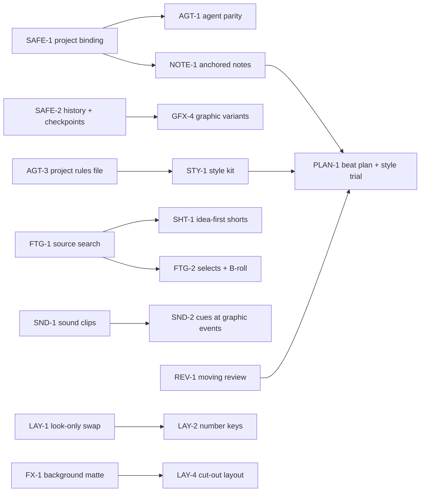

# Roadmap

The one ordered plan. It replaces the old backlog (`future-work.md`), the reconciled roadmap and
the six competing "recommended orders" in the research docs. Each item names its gap in
[gaps.md](gaps.md); decisions that block an item are in [decisions.md](decisions.md).

**Sizes:** S ≈ up to two days, M ≈ up to a week, L = more than a week.
**Rules for this file:** pick items top-down within a tier unless George says otherwise. When an
item starts, link its plan (in `plans/`); when it ships, move it to [Done](#done) with the date
and delete its details here. Keep IDs stable; never renumber.

## The logic of the order

**Milestones (decided 21 Oct):** (1) a great long-form tutorial, (2) tutorial shorts, (3) gaming
shorts and gaming videos. Everything in Now and Next serves milestone 1; shorts work (SHT-*)
follows; gaming work is not scheduled yet.

1. **Now: make what exists safe, complete and measured.** Small fixes, project binding, the
   missing agent operations, and a baseline to measure everything after against.
2. **Next: durability, a place for intent, and sight.** History that survives reopening, notes
   anchored to the edit, a user-owned rules file, a moving preview, and the basic craft surfaces
   (caption type, sound clips, graphics render quality, source search).
3. **Later: build the director loop on those foundations.** Beat plan and style trial on top of
   anchored notes; idea-first shorts on top of source search; cues on top of sound clips;
   finishing and delivery.

---

## Now

### EVAL-1 · A baseline evaluation set and a run report — S/M

- **Why:** every research doc asks for it, and without it no later item can prove it helped.
- **Do (decided 23 Oct):** two English inputs, the milestones in order: a long-form tutorial
  (`Untitled 22 Oct 2026 2.aero`, camera and telemetry) edited with the `tutorial` template, and
  a short from a take recorded for it (`Untitled 22 Oct 2026 3.aero`) with the `shorts`
  template, footage and graphics from the edited tutorial. Run each with a real agent and record
  wall time, agent tokens and cost, tool calls, human corrections, wrong cuts and misses, and
  provider spend (transcription, reviews). Greek is future work (LNG-4).
- **Output:** `plans/evaluation.md` with the numbers, rerun after each cost or quality change.

---

## Next

Rough order; the first four are the foundations the Later tier builds on.

### SAFE-2 · Persistent history and named checkpoints — M/L

- **Do:** keep the edit history on disk so undo survives reopen; one "undo what the agent did"
  step per agent run; named checkpoints ("clean cut", "approved look") that snapshot the edit
  document, graphic source folders and caption marks with their transcript stamp; restoring
  creates a new revision and invalidates pending proposals. Offer a checkpoint automatically
  before an agent workflow (the agent's version of "duplicate the project first").
- **Done when:** restore after a reopen and after more changes than the old 64-step stack.
- **Was:** backlog #13 (once turned down as "named versions/compare"; back as plain history).

### NOTE-1 · Anchored notes: comments the agent reads, and "Ask AI about this" — M

- **Why:** the most transferable idea in the research (feedback anchored to a time range, not
  chat), and the primitive several later features need (plan beats, review records, editor
  directions, production tasks).
- **Do:** one record type: `{id, anchor, text, author (user|agent), kind, status, revision}` where
  the anchor is word ids or a source range (mapped through clocks like layout sections), plus
  optional clip/graphic id and a normalised canvas rectangle. A Notes lane on the timeline and a
  context-menu "Note…" / "Ask AI about this" (copies a reference token the agent resolves).
  MCP: `notes` with `list` / `add` / `resolve`; `proposals_list` shows the user's reject note.
  Notes left by the agent ("unsure about this cut") show in the Agent panel.
- **Decided:** this is the one shared record for every "note about a moment" feature
  ([Q-PLAN](decisions.md#q-plan)): design `kind` and `status` so plan beats (PLAN-1), review
  marks (REV-1), spoken editor directions and short ideas (SHT-1) fit without new storage.
- **Depends:** SAFE-1. **Done when:** "move this away from the button" resolves to the selected
  graphic; a note survives cuts, and is flagged orphaned when its words are cut away.

### REV-1 · Moving review — M/L

- **Do:** (1) `preview_range(from, to)` renders a low-res, full-rate MP4 **with sound** of a range
  to a temp file and returns its path (clients that can play it, can; the user can always); (2)
  `playhead` op `show(t)` seeks the user's preview to a moment the agent wants them to look at;
  (3) a **join audition queue** in the UI built from retake cuts, uncertain word edges, leftover
  gaps and `check` findings: play ±2 s around each, mark keep / refine; (4) review records per
  revision (which ranges were inspected, listened to, decided), made stale by edits that touch
  them; (5) later, an encoded-output pass on the exported file (strips around each cut, loudness
  and true peak) tied to the file's hash.
- **Done when:** reports can say exactly which joins were heard, and a cut across a reviewed
  join marks it unreviewed.

### AGT-3 · A project rules file the user owns — M

- **Why:** the sharpest structural difference between our agent loop and every strong example:
  the method lives in a file the user owns and the agent improves.
- **Do:** first read the three published skills (Christian's Editing Skill, Tao's motion skill,
  Jason's blueprint artifact; one day). Then: rules at two scopes (this project, all projects),
  stored outside the installed `SKILL.md`; served with `template`; the agent may **propose**
  a rule (with the example that taught it), the user accepts in the Agent panel; the agent can
  say which rule shaped a proposal. Rejecting one cut never silently changes a rule.
- **Decision:** [Q-RULES](decisions.md#q-rules).

### AGT-4 · Readiness report and long jobs — S/M

- **Schema cost: done 23 Oct** (see Done). **Left:** a read-only `readiness` that works without a project (app/bridge versions, project and
  revision, models and runtimes installed, keys present yes/no, what is unavailable and why).
  Cancellation for long jobs. Smaller candidates to weigh here: a "state screenshot" (canvas +
  timeline + inspector at one moment), a time budget per stage that stops and asks, a diagnose
  action for a broken timeline. **Was:** backlog #16.

### GFX-1 · Graphics render policy: draft for preview, final for export — M

- **Do:** keep 30 fps / 1920 px for preview; at export, render graphics at the export's fps and
  slot size; both in the cache key; export never silently uses a draft.
- **Done when:** a 4K/60 export of a fast text graphic is visibly sharper and smoother than today.

### CAP-1 · Captions as typography — M

- **Do:** caption font and weight from the brand kit (bundled font files, Greek coverage
  checked); per-word **emphasis** stored on the transcript marks and chosen by the agent (the one
  word that makes you keep watching), drawn in the accent colour; two or three deterministic
  animation presets (word pop-in, karaoke highlight, static); caption ownership per range
  (native / inside a graphic / hidden).
- **Done when:** English and Greek captions with emphasis render identically in preview and
  export at 16:9 and 9:16.

### SND-1 · Minimal sound surface — M

- **Do:** clip gain and fade in/out on any audio clip (the `Clip` model has neither); SFX and
  music as their own audio tracks with roles; a speech-relative music level and a loudness
  target per project; a licence/provenance field on imported audio assets; agent ops through
  `propose_edit` + `settings`. No generation, no beat grid. Both libraries (SND-3) build on this.
- **Decision:** [Q-SOUND](decisions.md#q-sound): this comes first, then the SFX starter set, then
  music (SND-3). **Was:** backlog #5 (first half).

### FTG-1 · Search the source transcripts, including what was cut — M

- **Do:** `source_search(query)` over every saved transcript (word/phrase, word-boundary, light
  fuzzy), bounded results: asset/stream, source in/out, excerpt, word ids, and where it plays in
  the edit (or "cut"). The same search in a UI box (it is also Gather for shorts).
- **Done when:** finds labelled moments in a real tutorial, including one removed by a cut and one
  in an imported take. **Was:** backlog #14 step 1. **Unblocks:** FTG-2, SHT-1, take-short footage picker.

### DLV-1 · Subtitle and transcript export — S

- **Do:** SRT and VTT from the edited timeline (respecting hidden words and caption breaks),
  transcript as Markdown/plain text, and an audio-only export. For the video and each short.

### LAY-1 · Layouts: look-only playback swap, then measure — M

- **Do:** layout/style-only edits swap a new resolved-layout `Arc` into the running evaluator
  instead of rebuilding evaluator and mixer; drags preview on the front end and commit on
  release. Then `perf.rs` on a real `.aero` with ~30 sections (p50/p95 frame time).
- **Plan:** [plans/layouts.md](plans/layouts.md). **Unblocks:** LAY-2.

### VER-1 · Pay the verification debt — M

- **Do:** on a disposable project, through the real bridge: inspect → propose → accept → inspect
  → undo → render → export → check the file, on Windows **and macOS**; a real Codex session with
  write tools; the templatize → check → save loop over MCP; a brand kit with a font file and logo
  in a real render. Record host-verified coverage in [product.md](product.md#what-is-verified-and-what-is-not).

---

## Later

Grouped by area. Order within a group is the suggested order.

### Direction: plan, style, method

- **PLAN-1 · Beat plan and style trial (L).** On NOTE-1 records: per beat an anchor, purpose
  (hook / explanation / proof / payoff / rest), treatment (layout, graphic + variables, caption
  ownership, sound intensity), reason, user locks, status (draft → approved → built → stale).
  A transcript-row panel; `plan` op on `notes`. Then a **style trial**: build 2–3 beats on a
  5–10 s range, approve the look, then scale. Graphics keep their word anchor (fixes C3).
  Plan beats are NOTE-1 records with `kind: beat` (decided, [Q-PLAN](decisions.md#q-plan)).

- **STY-1 · Style kit (M).** Beside the brand kit, referencing it: caption rules, motion
  character, graphic density and placement, sound policy, a few reference images and files;
  separate long-form and shorts profiles. Some rules checkable by `graphic_check`, not all
  (pacing needs judgement). Builds on AGT-3's storage. Decision: [Q-RULES](decisions.md#q-rules).

- **AUTO-3 · "Save this workflow" (M).** From an approved edit: instructions, defaults,
  exceptions and checks as a named, versioned workflow shown as a readable summary first. Proven
  only when reused on a second tutorial with different footage.

### Graphics

- **GFX-3 · Templates for real tutorial jobs (M + design).** Word-timed emphasis (each word at
  its own word id, re-timed after cuts); highlight a real UI target; step sequence; before/after;
  a lower-half overlay prototype. Purpose tags and search in the library. 8–12 total, all
  passing the gate with real English and Greek copy.

- **GFX-4 · Graphic variants (M).** Independent variant folders with source snapshots;
  Create / Revise / Compare / Use; "Use this version" is one undo step; revision scope (element /
  graphic / scene) so a colour fix never regenerates a sequence. Depends on SAFE-2.

### Sound

- **SND-2 · Cues at graphic events (M/L).** Templates declare event markers (card lands, counter
  completes); a small procedural palette (tap, tick, pop, chime, airy whoosh, impact) plus
  imported files; a deterministic cue compiler (`cueStart = visualPeak − soundPeakOffset`,
  density limits, ducking); the agent picks which events deserve sound; sound style in words
  from STY-1. Depends on SND-1. **Was:** backlog #5 (second half).

- **SND-3 · Sound and music libraries the user extends (M/L).** First an SFX starter set of
  ~15–20 hand-picked, licence-clean sounds (a few whooshes, UI clicks and pops, two risers, two
  hits), tagged and auditioned; then a copyright-free music library. Each has browse, preview,
  search by tag and one-click placement, and takes the user's own files. **Music must never need
  credit (enforced):** every track stores its licence; the built-in library holds only tracks
  allowed for monetised use without attribution (CC0 / public domain or equivalent); a track that
  requires credit, forbids monetisation or has an unknown licence is refused for the library, and
  a user import like that is flagged in the project and by `check` before export. Comes after
  the project rules and style kit (decided order). Depends on SND-1.
  Decision: [Q-SOUND](decisions.md#q-sound).

### Footage

- **FTG-2 · Selects and B-roll from own footage (M).** Named source ranges with notes; a reviewed
  placement batch: video-only streams, a free overlay track, narration untouched, word-anchored
  so later cuts re-resolve it. Depends on FTG-1. **Was:** backlog #4 (own footage first).

- **FTG-3 · Scene descriptions (M).** Agent-written descriptions and tags from sparse contact
  sheets, cached against source fingerprints; OCR for UI labels if keyword search misses.
  **Was:** backlog #14 next steps.

- **FTG-4 · Ordered take and script-guided assembly (M).** Natural ordering of take names
  (`1.2`, `1.10`), missing/duplicate takes shown; match a supplied outline to source transcripts,
  alternatives shown, one proposal batch.

- **FTG-5 · Import an outside transcript (S).** Deepgram / AssemblyAI / Rev JSON → our word model,
  Not needed (21 Oct); do it only if it stays this small.

- **FTG-6 · Stock B-roll providers (M).** Pexels / Pixabay with the user's key, licence recorded,
  download only on accept. **Was:** backlog #4.

### Shorts — plan: [plans/shorts.md](plans/shorts.md)

**Decided 22 Oct:** two features in two tabs that share their parts. **Shorts** start from a take
recorded outside the app (camera and voice); everything else goes under it. **Clips** cut the best
moments out of the long video (what the Shorts tab does today besides takes). Shorts from a take
come first, in this order: SHT-5, SHT-6, SHT-4, SHT-3, SHT-2; Clips (SHT-1) after.

- **SHT-1 · Idea-first clips (L).** A clip is an idea plus pieces gathered from anywhere in the
  video. Depends on FTG-1. Comes after the take-first Shorts work.

- **SHT-2 · Caption shaping in shorts (M).** Breaks, emphasis and hidden words per short; text
  fixes shared with the video.

- **SHT-3 · Dress step (S/M).** Graphics into the short's slots as the last step, as a review batch.

- **SHT-4 · Take-short follow-ups (S).** Speed/freeze fit modes, per-short ducking amount. (The
  picker is done, 23 Oct.)

### Layouts — plan: [plans/layouts.md](plans/layouts.md)

- **LAY-2 · Switch layouts with keys (M).** The user binds layouts to keys in the shortcuts menu;
  pressing one while playing applies it from the playhead to the next section edge; live through
  the look-only swap, one undo step on stop; MCP `layouts op: switch`. Depends on LAY-1.
  **Was:** backlog #10.

- **LAY-3 · Auto layouts with limits (M).** Tella-style rules on top of `pick`: a few changes per
  minute at most, length windows (screen 2–8 s, camera 2–5 s, punch-in 1.5–4 s), camera on the
  side the face looks away from; the app proposes, the agent reviews with `list` + storyboard.
  **Was:** backlog #11.

- **LAY-4 · Presenter cut-out layout (M).** Depends on FX-1's matte.

### Finishing and effects

- **FX-1 · Webcam background removal, blur, replacement (L).** A segmentation matte computed once
  per recording and cached like face tracks, composited in wgpu. Also enables text drawn behind
  the presenter. **Was:** backlog #9.

- **FX-2 · Tutorial effects (M).** Spotlight, redaction/blur of a region, magnifier, dim/blur
  under a graphic: time-bounded rectangles anchored to the screen layer, correct through crop,
  zoom, layout changes and cuts, in preview and export.

- **FX-3 · Camera push-ins (M).** Start/end scale, pivot, easing, hold, return; matched framing
  across jump cuts; separate from screen zooms.

- **FX-4 · Audio seam fades (S).** Short fades at cuts where source handles allow, speech timing intact.

- **FX-5 · Colour: LUT import and a simple grade (M). Parked 21 Oct: not needed now.** Per clip,
  preview/export parity, `clip_grade` op.

### Delivery

- **DLV-2 · Delivery list (M).** Video + shorts + sidecars as one queue; per-output status,
  retry, the revision each output rendered.

- **DLV-3 · Graphic export with alpha, then a constrained NLE handoff (M → L).** ProRes 4444 /
  WebM alpha for one graphic; then a cuts-only timeline (FCP7 XML or OTIO) tested in the
  destination editor with a report of what was flattened. **Was:** backlog #15.

- **DLV-4 · Translated subtitles (M).** Greek ↔ English cues with stable source anchors and their
  own revision history; glossary for product names. Dubbing stays out (YouTube auto-dubs).

- **DLV-5 · Real reformat 16:9 → 9:16 (L).** One operation that keeps UI targets, cursor
  relationships and reading time, not just the canvas size.

### Languages and transcription

- **LNG-1 · Greek word aligner.** Dropped 22 Oct 2026: word alignment was removed altogether
  (it did not help in practice).

- **LNG-2 · More languages (S each).** Filler words, question mark and an online provider per language.

- **LNG-3 · More transcription models (M).** Local Greek (Cohere Transcribe once it runs here and
  LNG-1 exists), Qwen3-ASR 1.7B if Parakeet's mistakes show, other OpenRouter speech models.
  **Was:** backlog #12.

- **LNG-4 · Filler/retake rules fixes and a real Greek eval (S/M).** Rules stop treating
  "X. X essentially means" as a retake (list items and parallel statements: done 22 Oct); flag single-word repeats, cut-off words and
  short restarts; label one more real English recording and a real Greek one; then decide whether
  cloud review may default to `apply: true` for fillers. **Was:** task 3 leftovers.

- **LNG-5 · Custom vocabulary (S/M).** Product names and jargon passed to providers that accept them.

### Automation

- **AUTO-1 · Run a template on request after opening (S).** Replaces folder watch, which was
  turned down: nothing starts when a recording finishes. After opening a project the user picks a
  template (tutorial, shorts, take-shorts…) and the saved method runs up to its first question,
  with only free local steps unless the user confirms. Builds on AGT-3's rules and the existing
  saved answers. Decision: [Q-WATCH](decisions.md#q-watch).

- **AUTO-2 · Speech matching across takes (M).** Measured speech-level matching (then gentle EQ)
  so a re-recorded sentence doesn't jump.

### UI

- **UI-1 · Thumbnails on clips (M).** Tiny, cached per source, only when the track is tall enough,
  cancelled when scrolled away. **Was:** backlog #7.

- **UI-2 · Basic and Advanced settings (M).** Inventory every panel's settings first, then split.
  **Was:** backlog #8.

- **UI-3 · Templates (saved looks): save over, remove, add (S).** Decide what a look holds
  (layout, audio, captions, zooms, cleanup choices, brand kit). Rename the Tauri
  `templates_list` / `template_save` / `template_apply` family to `looks_*`, so
  "template" means only the agent's workflow templates. **Was:** backlog #6.

### Dependencies

- **DEP-2 · Recurring dependency review (S each).** Follow the cadence in
  [dependencies.md](dependencies.md): read changelogs, update on a branch, run tests, `perf.rs`
  and the parity probes, record the result. Candidates already visible: React 18 → 19,
  Vite 5 → current, Tailwind 3 → 4, `ort` leaving release candidates, HyperFrames past 0.8.162.

### Performance

- **PERF-3 · Dense timelines and the JPEG fallback (M).** Draw sub-pixel clip runs as one strip
  per track at full view (O01); two alternating encoder threads for the non-wgpu preview path
  (O02).

### Agent cost and quality — 99 % of the quality for 10 % of the price

Raised 23 Oct as long-term direction. Every item here is measured against
[EVAL-1](#eval-1): keep a cheaper path only when the edit stays as good.

- **COST-1 · Review boards (M).** One image per minute of video: 60 small tiles, one a second,
  in order (the storyboard's sheet, made denser), so an agent reviews a minute for the price of
  one image. Then cheaper still: a coarse, compressed board first (fewer, smaller tiles, JPEG or
  WebP) for the rough idea, and a sharper board of one stretch only where something looks off.
  Measure tokens per reviewed minute and what the agent still catches.

- **COST-2 · Tools on demand (S/M).** Today 55 tools, 72,722 characters (~18k tokens) in the
  list, about 330 tokens a tool. Claude Code already loads an MCP tool's schema only when it is
  used; other clients send the whole list. Measure per client (Claude app, Codex, Claude Code),
  then send a small core set (status, template, scan, transcribe, the cleanup passes, chapters,
  check, export) with the rest named in a line each and described on request.

- **COST-3 · Cheaper reviewers (M).** Hand narrow judgement jobs (looking at a board, filler
  windows, chapter titles, checking a graphic) to a smaller model or a lower reasoning effort,
  through a subagent or the app's own OpenRouter pass with a cheap model; the main agent keeps
  the decisions. Each swap kept only if EVAL-1 says the result is as good.

- **STY-2 · Styles from references (M).** The agent studies a reference (a video as review
  boards, images, a channel's thumbnails) and writes a style kit, a brand kit and two or three
  graphic templates in that style; the user picks what to keep, and it goes into the library.
  Cheap because it reads boards (COST-1), not whole videos. After STY-1.

- **LOOP-1 · The user and the agent improve the app together (L).** Aim: a loop where each edit
  makes the next one better: the app, the bundled material (templates, styles, rules) and the
  taste. Records what the user changed after the agent (proposals accepted or rejected, cuts
  restored, graphics redone) and turns patterns into proposed changes to the rules file
  ([AGT-3](#agt-3)), templates and style kits, each accepted by the user. Data-driven, never
  free-text rules learned on the side (the 17 Oct condition for bringing learning back).

### Code health

- **QUAL-1 · Code reuse check (M), later.** Asked for 22 Oct: the same logic is often written
  again instead of shared, which costs time and causes bugs that are fixed in one copy only.
  Sweep the Rust passes, the MCP actions vs the UI commands, and the front-end panels and dialogs
  for repeated logic; move it into shared helpers with tests; note the patterns to reuse in
  `architecture.md` so new work starts from them. Seen so far: the same Tauri event-listener
  effect written out in `App.tsx` and several panels; line-ending-safe edits; Clips and Shorts
  must share one set of short panels (SHT-5).

### Ideas not yet scheduled

Kept so they aren't lost; promote one into a numbered item when a real edit needs it.
Alternate full-length timelines for review; record a narration fix at the playhead (or import one
from AeroShoot); media bins and relink repair; copy scenes and clips between projects; export an
arbitrary range as a reference clip; cover frame / thumbnail selection; title and description
drafts; a reduced-motion style; safe zones as versioned delivery presets with phone-size
inspection; storyboard tiles keyed to music beats.

---

## External: the AeroShoot recorder

Not this repo, but they affect edits: write exact segment boundaries instead of overlapping by up
to a frame (O03), and remove the 10 ms system-audio gap at each segment boundary (O04). The
editor already tolerates both.

## Done

Most recent first. Details live in git history and the plans.

- **23 Oct 2026** — **Fewer agent calls**, measured by rerunning EVAL-1: automatic mode passes
  `guard: true` to `mouth_noises`, `silence` and `fillers` and the app applies its own
  "looks wrong" check instead of a dry run first (takes not guarded); `graphic_add` takes
  `items`, one call and one undo step. Tutorial: 34 → 20 calls, $0.41 → $0.36. Cost is now
  mostly writing the context (tool list, template, transcript), the case for COST-2.
- **23 Oct 2026** — **EVAL-1 baseline** ([plans/evaluation.md](plans/evaluation.md)): a real
  agent (Claude Code headless, Sonnet 5.5, the app's MCP server only) edited George's 7-min
  tutorial for $0.41 in 34 calls and made a short from a take for about $0.30 in a clean run.
  Fixed from it: quiet microphones' word tails cut by the tight pass (edges stay 24 dB below
  the speech level), take words looked up by their kept part, `shorts` `op: rename`, the
  first chapter reported at 0:00, and one graphic render per graphic (storyboard and export
  asked for 1082 and 1080 wide).
- **23 Oct 2026** — **SHT-6b** the agent's picks under a take are one batch:
  `short_footage` `op: add` takes footage, files and graphics (`template`, `library`, or
  `graphic`, a copy of one of the video's) in one call and proposes them; the app checks them
  on a copy (graphics made in a scratch folder) and the user accepts or rejects the batch in the
  Agent panel ("Under a take", with "Show the short"), applied as one undo step; autopilot
  accepts at once. It goes stale only when the short or the video's timeline changes.
  `graphic_add` no longer takes `short`. One routine places for the Shorts tab and the batch
  (`under_take.rs`). Tested: agent-level (propose changes nothing, accept is one step, stale,
  autopilot); live in the dev app.
- **23 Oct 2026** — **SHT-4 picker and SHT-6b in the app**: the Shorts tab's "Take and what plays
  under it" puts things under a take by hand, at the timeline's selection or from the playhead:
  **Video** (search the video's lines, click one: its footage), **Graphic** (a copy of one of the
  video's, a library item or a template; `project_short_graphic_add`, the agent's placement) and
  **File** (imported videos and pictures, Import files…). One list of everything placed, each
  with go-to and remove. Tested: line grouping and placement (front-end), the command's JSON
  shape (Rust); live in the dev app.
- **23 Oct 2026** — **SHT-6** everything under a take, for agents: graphics go
  on a take short's own timeline (`graphic_add` with `short`, at a word of the take): a new one
  from a template or the library, or **a copy of one of the long video's graphics**
  (`graphic`), re-rendered at 9:16 with its text changeable apart from the video's;
  `graphic_render` takes `short`. Footage can come from an imported file as B-roll
  (`short_footage` items with `media`/`mediaS`, sound ducked like the video's). One placement
  routine for the video and shorts (`graphics::place_on`), and one short lookup in the agent
  tools (QUAL-1). Tested: unit and agent-level tests; live on the 21 Oct recording, its storyboard
  shows the footage, the copied "Standex closes down" card and a new key point at 9:16.
- **23 Oct 2026** — **SHT-5** Shorts and Clips are two tabs over one `Short`
  model and the same panels: **Shorts** lists the shorts made from a take and opens on the take
  form; **Clips** lists the stretches cut from the video, with New clip and Find with AI. The
  store knows the tab showing (`kind`), so the picked short, the preview and exports stay in it.
  The agent's templates follow: `shorts` is the take-first one, `clips` the old `shorts`.
  Checked in the app: each tab lists only its kind, a clip made in Clips doesn't show in Shorts.
- **23 Oct 2026** — **GFX-2** GSAP in graphics: GSAP 3.15.0 (the version
  HyperFrames 0.8.162 links from its CDN) is fetched from npm onto the user's computer once
  (sha256-pinned, at runtime install or when a graphic first loads it; never in the repo or
  installer, since its licence terms page did not load) and staged beside a graphic for the gate
  and every render (`graphics/gsap.rs`). A CDN link to GSAP is rewritten to the local file name
  when a page is written, and the network check lets it through, so a composition written the
  HyperFrames way passes without a rewrite. `blank` is now a GSAP starter (one paused timeline in
  `window.__timelines["graphic"]`); the six cards stay on the Web Animations API. Tested live:
  the GSAP blank, written with a jsDelivr link, passes all 12 gate checks; all six cards still
  pass. **AGT-4 (schema cost)** the MCP tool list agents read on every connection went from
  84,414 to 72,722 characters (−14 %, ~2,900 tokens): `$schema`, `title`, `format` and
  `default: null` are left out of what agents are sent, "X or null" is written as
  `type: [X, "null"]`, the `project` parameter is explained once in the rules, and one
  duplicated description shortened. Checked: all 55 tools take exactly the same arguments
  (names, types, required, allowed values) and keep every description; a test keeps the list
  under 75,000 characters. `aeroedits do --help` keeps the full schemas.
- **22 Oct 2026** — **PERF-1** transcript panel: words and lines are indexed
  once per transcript (`lib/transcriptIndex.ts`, binary search for the playing word and line) and
  only the lines on screen are drawn (`useLineWindow`, measured heights, spacers; a hidden panel
  draws nothing). Measured in the dev build on 9,500 words (an hour of speech) packed into an
  11-minute recording, old and new back to back in the same page: reload 583 → 310 ms until drawn
  and 350 → 186 ms of main-thread blocking; DOM 12,344 → 517 nodes; playback 13.0 → 6.5 ms of
  script per playhead move, frames over 1/60 s 28 → 1 of 300. Seeking far ahead or back still
  brings the playing word into view; selection across lines and scrolling to the end work.
  **PERF-2** lazy loading: the editor (`DockWorkspace`) loads only once a
  project is open (fetched in the background once the start screen is up), panels outside the
  Edit layout and every dialog when first shown. Production build: the start-up script 966 →
  236 KB (262 → 74 KB gzipped), start-up CSS 184 → 48 KB; cold start in headless Chrome (median of
  15, cache off) 142 → 110 ms until the start screen shows, 284 → 86 KB fetched.
- **21 Oct 2026 (night)** — **AGT-2** thorough mode and an honest report
  (skill only): the tutorial template asks "fast or thorough" with the first questions and saves
  it (`review` in the saved answers; automatic uses it, else fast). Thorough reads every kept
  word in two-minute stretches for abandoned sentences, restarts in other words, tangents and
  repeats (keeping deliberate repeats, lists and waits), proposes those cuts in one batch, runs
  the in-house thorough review when the local model did the fillers, views every retake join and
  long gap with `timeline_view`, and gives the user a listening list. The closing summary keeps
  **Done / Looked at / Not heard / Approved by you / Still open** apart; SKILL.md and the server
  instructions say the same. **Not verified yet** with a real agent run on a recording with an
  abandoned sentence outside the rule windows (needs EVAL-1's recordings).
- **21 Oct 2026 (night)** — **AGT-1** agent parity for cleaning up and
  correcting: `zooms` `list` / `create` / `update` / `remove`; `graphic_set` `moveToUs` /
  `moveToWord` / `remove`; `chapters` `set` (agent-written, by word or time); `shorts` `remove`
  and `range` (a new stretch follows the video again, its own cuts dropped in the same undo
  step; take shorts refused); `export` `cancel`; `media_import` `roles` (also on media already
  imported). Three small new tools instead of making read-only listings writable:
  `transcript_fix` (not an undo step; it reports the old text), `brand_kit_set`,
  `library_remove` (56 tools now). The tutorial template and skill now have the agent write the
  chapters itself. The SAFE-1 limit is closed: `opened()` refuses a call bound to another
  project, and the commands it runs re-check that handle under the command lock. Tested: zooms,
  graphic move/remove, chapters, shorts, word fixes and roles (`brand_kit_set` and
  `library_remove` are thin wrappers over the UI's tested commands; not tested through MCP).
- **21 Oct 2026 (evening)** — the first five Now items:
  - **FIX-1** the graphics render queue now only replaces a waiting render
    for the same graphic *and* the same output (canvas, length, fps, entrance), so the video
    and a short at another length both render (`Spec::supersedes`, tested).
  - **FIX-2** `SKILL.md` and the `settings` description say per item what is
    on by default (`webcamAutoHide`, `windowCrop`) and off (`soundEffects`).
  - **FIX-3** `export`, `graphic_render`, `graphic_check` are no longer marked
    read-only; `destructiveHint` is set for tools that overwrite without undo (`export`,
    `graphic_set`, `graphic_write_file`, `library_save`, `template_save`); `propose_edit`
    publishes a real schema of all 17 edit kinds, derived from `SequenceEdit` (tested). The
    Tauri `template_save` rename moved to [UI-3](#ui-3), since it belongs to the whole
    saved-look command family.
  - **SAFE-1** agent calls are bound to the project they were meant for:
    `project_info`, `status` and `proposals_list` report the open project's `project` id; every
    writing tool accepts `project` and is refused if another project is open (a reopen counts,
    since the id is new per open); `propose_cuts`, `propose_edit` and `undo_batch` require it,
    and proposals check it again under the command lock. Tested: a stale proposal after a
    reopen with the same revision and clip ids is refused and stores nothing. Skill and server
    instructions updated. Direct actions still check before they take the lock: see
    [AGT-1](#agt-1).
  - **DEP-1** Rust pinned to 1.92.0 (`rust-toolchain.toml`, CI), Node 22
    everywhere (`.nvmrc`, CI, README; CI was on Node 20, past end of life), FFmpeg pinned to the
    BtbN 30 Sep 2026 month-end build `n8.1.3-9-g29e619e767` with hard-coded checksums (verified
    by a real download), `Cargo.lock` now committed. See [dependencies.md](dependencies.md).
- **21 Oct 2026** — Layouts: base layout + timed sections on every timeline, favourites, pick
  rules, face framing on every camera slot ([plan](plans/layouts.md)). Local vs cloud filler
  review measured; cloud is the default, local only without a key
  ([eval](plans/local-review-eval.md)). Clip speed 0.25×–8× ported. Docs consolidated.
- **20 Oct 2026** — Greek (online), Parakeet Unified EN + Verbatim, the CUDA 13 GPU pack, local
  Qwen3.5 4B review on Vulkan; sound effects off by default; fillers use rules + AI by default.
- **18 Oct 2026** — Shorts as a workspace tab; take shorts (`short_from_take`, `short_footage`).
- **17 Oct 2026** — Word alignment (wav2vec2); face framing (YuNet); fast switching between shorts.
- **13–16 Oct 2026** — AI readiness phases 0–3: MCP bridge, proposals and Agent panel, app actions
  and CLI, skill and templates, `check`, shorts scenes, graphics v1, brand kits, library + gate
  ([plan](plans/ai-readiness.md)).
- **4–5 Oct 2026** — Premiere-style tracks (one sequence model, clocks); performance pass R01–R20.

## Old numbers → new IDs

For anything (memory notes, commit messages, old chats) that still says "task N".

| Old | New | Old | New |
|---|---|---|---|
| #1 More layouts | Done; follow-ups LAY-1…LAY-4 | #10 Number keys | LAY-2 |
| #2 More languages | LNG-1, LNG-2 | #11 Auto layouts | LAY-3 |
| #3 Measure local review | Done; LNG-4 | #12 Transcription models | LNG-3 |
| #4 B-roll | FTG-2, FTG-6 | #13 Version history | SAFE-2 |
| #5 Music and SFX | SND-1, SND-2 | #14 Source search | FTG-1, FTG-3 |
| #6 Templates | UI-3 | #15 NLE handoff | DLV-3 |
| #7 Clip thumbnails | UI-1 | #16 MCP discovery | AGT-4 |
| #8 Simpler UI | UI-2 | #17 Project binding | SAFE-1 |
| #9 Background removal | FX-1 | Known issues F05 / F06 / render queue | PERF-1 / PERF-2 / FIX-1 |
